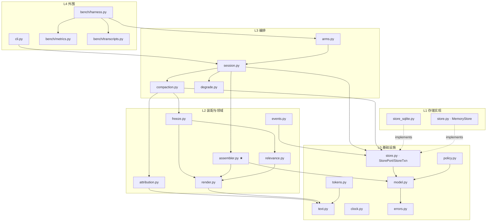

# C1 形态上下文存储 SDK —— 架构设计

> 状态：设计稿（C1）。本文只定义**骨架、边界、签名与参数**，不含实现代码。
> 上游口径：[`MEASUREMENT-SPEC.md`](./MEASUREMENT-SPEC.md)（验收口径，不可改）、
> [`TRANSCRIPT-FORMAT.md`](./TRANSCRIPT-FORMAT.md)（bench 唯一输入）。
> 本文与上述两份冲突时：**测量口径以其为准，装配语义以本文为准**，冲突点必须在 §13 记录在案。

---

## 1. 问题定义

### 1.1 现状：智能在提示里，代码只记账

现有资产 `D:/skill/context-lattice/` 是一个**给模型看的技能包**：

| 资产 | 规模 | 性质 |
|---|---|---|
| `SKILL.md` | 227 行 | 提示契约：T/P/R 拆分规则、作用域判定、生命周期、红线纪律 |
| `scripts/ctx.py` | 2065 行，纯标准库单文件 | 结构化记账：`parse` / `render` / `apply_delta` / `_body_key` / `save` / `event` / `fetch` / `plan` |

它的关键是：**判断（切分、归属、要不要记）全部由模型完成；代码只保证写入的结构合法、幂等、可校验、可复现。**
这个分工是对的，必须原样继承到 SDK 里——SDK **不做语义理解**。

### 1.2 要变成什么

宿主不再"每轮把全量历史重发"。调用方把本轮用户消息交给 SDK，
SDK 从存储里**装配**出一份 provider 可直接发送的 payload：

```
[S] 静态 system  →  [F] 冻结记忆块  →  [R] 最近原文轮  →  [U] 本轮用户消息
```

上下文由**存储**决定，而不是由**对话历史堆积**决定。这是 C1 与现有技能包的本质差别：
技能包是"模型每轮自己去读库"，SDK 是"库直接产出 payload"。

### 1.3 现成代码里哪些能直接搬

| 现有能力 | 处置 | 落点 |
|---|---|---|
| `parse` / `render` / 20 条结构不变量 | **搬**（改造为内存树 ↔ 文本双向） | `render.py` + `store*.py` 校验层 |
| `apply_delta` 幂等归并、改标记语义 | **搬**（一字不改的行为契约） | `attribution.py` |
| `_body_key` 内容指纹 → rev 只在真变化时 +1 | **搬** | `text.py` |
| `save` 原子写（唯一临时名 + `os.replace`） | **搬**（SQLite 事务替代，见 STORE-SCHEMA） | `store_sqlite.py` |
| `event` / `fetch` 的 `DRIFT` / `MISS` / `STALE-SRC` 三态 | **搬**（状态机原样保留） | `events.py` |
| `plan` 预算门控 | **搬到 bench 侧**（建库前的收益判定，不进装配热路径） | `bench/` |
| `read --level 1/2/3` 渐进披露 | **改造**：`level` → 冻结块的分层 tier | `freeze.py` |

---

## 2. 设计公理（后续所有决定都从这里推）

| # | 公理 | 直接推论 |
|---|---|---|
| **A1** | **智能在提示里，代码只记账** | SDK 不调用 LLM、不做向量检索、不做归属抽取；归属由调用方（模型）给出，SDK 只校验+持久化 |
| **A2** | **冻结段不可变** | `F` 只在压缩边界重写；边界之间 `S`/`F` 一个字节都不动 |
| **A3** | **装配是纯函数** | `assemble()` 不碰 IO、不读时钟、不读环境变量、不读随机源。确定性靠**结构**保证，不靠纪律 |
| **A4** | **fail-open 只覆盖单轮装配** | `send()` 永不抛异常；但**配置错误在构造期大声抛**（错参数是程序缺陷，不该被静默吞掉） |
| **A5** | **口径可复现优先于数字好看** | 不确定的一律标 `degraded` / `mode=estimate`；宁可报负收益 |
| **A6** | **单向依赖** | `bench → arms → session → assembler → freeze → relevance → render → store.Port → model/errors`；任何反向 import 视为架构违规 |
| **A7** | **审计字段不得参与控制流** | 记录「这份 payload 是从哪份内容冻结的」是**审计**；判断「这份冻结块还能不能用」是**控制流**。前者变化是设计意图，把它当闸门会让系统退化成「每轮都是边界」——而退化路径**不报错**。判据见下 |

> **A3 是最重要的一条架构约束。** 装配一旦读了时钟或环境，`cached_i` 就会在没有报错的情况下崩掉，
> 成本静默上升 5–10 倍而**没有任何信号**。见 §5.3（I1）与 §11.3。

> **同一个手法本文用了四次**：A3（装配器不给存储入口）、I6（F 不在装配期重算）、
> I16（`rev` 与压缩脱钩）、§10.4（降级层不给解释权）。
> 共同点不是"分层"，是**剥夺**——**把判断权从会忘的人手里，交给不会忘的结构。**
>
> 做成的方式也只有一种：**拿走输入。**
>
> | 约束 | 拿走了什么 |
> |---|---|
> | A3 | 装配器没有 IO / 时钟可读 |
> | I6 | 装配期没有"重算 F"的路径可调 |
> | I16 | `body_hash` 没有 plan 的输入 |
> | §10.4 分派 | 降级层没有解释业务的输入，只有一个类型 |
>
> 于是"这条能不能靠结构"可以问成一个**可判**的问题：
> **我能不能让它根本拿不到那个输入？**
> 拿不到 → 是结构；**拿不到但还留着接口 → 那只是纪律换了个名字。**

### 2.1 A7 的判据与四个已知实例

**判据（每个字段做 `if` 之前必须回答）**：

> 这个字段在**正常运行**时会不会合法地变化？
> **会变的，只能进日志，不能进判断。**

这条判据不针对某个字段，而是针对一类错误。本项目已发生过四次，形态各不相同：

| # | 错误 | 把什么当成了什么 | 静默后果 | 谁发现 |
|---|---|---|---|---|
| 1 | 只存 `frozen_sha16`，不存 `frozen_text` | 把**哈希**当成了**F 本身** | 装配期只能重算；而边界间归因写入会改库 → 重算结果变 → 前缀断 | 自查（§5.4） |
| 2 | `plan.store_rev != 当前 rev → PLAN_INVALID` | 把**冻结时的快照版本**当成了**有效性闸门** | 每轮都判失效 → 每轮重压 → 每轮全价轮 | 宋砚秋的 P8 发现引出（§9.1） |
| 3 | 把 `snapshot_id` 当作"plan 是否仍匹配当前库"的依据 | 同上，把**内容指纹**当成**有效性** | 同 2 | 同 2 |
| 4 | 对**全表**校验 `snapshot_id`（含历史 generation 行） | 把**历史行的合法不一致**当成了**损坏** | 每个旧 generation 都报 `StoreCorruptError`，而库完全健康；随后必然有人去"修"，把健康库改坏 | 宋砚秋（P6 落地）|

四者共同点：**不改正确性，只吃掉方案的全部收益，且不产生任何错误信号。**
它们无法被"功能是否正常"的测试抓住，只能被"成本是否异常"的测试抓住。
前三个是"把会变的东西当成了不会变"（收益流失），第四个是"把该变的东西当成了不该变"（健康库被判坏）——
方向相反，但都是同一句话没问：**这个字段在正常运行时会不会合法地变化？**

**因此配两条常开测试**（见 §11.3）：

1. **正向**：`attribute()` 改写内容后，下一次 `send()` **不得**是边界轮；
2. **否定式（更狠）**：40 轮 `good` transcript 的边界数必须等于 `1 + floor((40-1)/N)`。
   对 `N=12` 即 **4**。若某实现报出 40，就是"每轮全价轮"这个退化的显式否证。

> 第 2 条的形状值得记住：它不是在断言"某功能正常"，而是在断言"某个特定退化**没有发生**"。
> 对 A7 这类错误，只有这种形状的断言才有用。

### 2.2 A7 的机械检查形态（可 grep，建议做成常开）

A7 的四个实例**全都不报错**，靠人工 review 抓本来就不现实。所以纪律必须落成一条能扫描的形态：

> **审计字段只许「写入」与「原样输出」，不许参与比较后抛错或降级。**

| 项 | 内容 |
|---|---|
| **审计字段清单** | 见 **附录 A.0「审计字段登记」**——那是唯一清单，本节不复制（复制必然漂移，而漂移的表现是"检查还在跑，只是少查了一个字段"） |
| **违规形态** | `if <审计字段> != … : raise` / `: return <降级>`；或该字段出现在任何 `PLAN_INVALID` 判定链上 |
| **允许形态（仅此两种）** | ① **写入**：构造 SQL、赋值；② **原样输出**：进 payload 的审计段、进 `report.md` / `turns.csv` |
| **豁免** | 必须显式登记在此处；不登记即违规（否则会退化成满屏豁免注释，等于取消检查） |

**为什么 `store.updated_at` 也要进清单**：它的误用形态最自然——「上次更新早于本次边界 ⇒ plan 过期」。
听起来是常识，实际与 `store_rev` 那条是同一个错误：F 本来就该是旧的。
它现在没人这么用，但"早晚有人写"的概率很高，进清单的成本是一行字。


---

## 3. 模块清单与分层

### 3.1 文件树

```
ctxlattice/                                  # 仓库根
├── pyproject.toml                           # 无强制第三方依赖；extras: [bench]=tiktoken
├── README.md
├── ctxlattice/
│   ├── __init__.py                          # 公开面：只 re-export，无逻辑
│   ├── errors.py                            # 异常层级（全部内部，边界处捕获）
│   ├── model.py                             # 不可变数据模型（Turn/Payload/Plan/...）
│   ├── policy.py                            # Policy 参数 + 校验 + 边界判定
│   ├── clock.py                             # ClockPort / SystemClock / LogicalClock
│   ├── tokens.py                            # TokenCounter：精确(tiktoken) / 估算
│   ├── text.py                              # 归一化 / 校验 / 指纹（_norm/_check/body_key/sha16）
│   ├── store.py                             # StorePort / StoreTxn 协议 + MemoryStore 参考实现
│   ├── store_sqlite.py                      # SQLite 实现（schema 见 STORE-SCHEMA.md）
│   ├── attribution.py                       # 增量校验与幂等归并（apply_delta 语义）
│   ├── render.py                            # 逐字节稳定的渲染器（唯一出字节的地方）
│   ├── relevance.py                         # 确定性相关子树选取（无模型）
│   ├── freeze.py                            # 冻结块构建（仅在边界调用）
│   ├── assembler.py                         # ★ 核心：纯函数装配
│   ├── compaction.py                        # 边界执行器（事务性重冻结）
│   ├── events.py                            # 事件节点登记 / 取回 / 三态校验
│   ├── degrade.py                           # fail-open 机制与降级事件
│   ├── session.py                           # 编排：send/observe/attribute + 状态机
│   ├── arms.py                              # ArmProtocol / BaselineArm / LatticeArm
│   ├── cli.py                               # [可延期] 只读调试 CLI
│   ├── prompts/system.md                    # S 段默认文本（按 sha 钉住）
│   └── bench/
│       ├── __init__.py
│       ├── transcripts.py                   # JSONL + meta.json 读取与哈希
│       ├── metrics.py                       # 计费三层口径（严格照 MEASUREMENT-SPEC §3）
│       └── harness.py                       # 跑臂、出 report.md / turns.csv / summary.json
├── bench/
│   ├── transcripts/{good,bad,none}-*.jsonl + *.meta.json
│   └── results/<yyyy-mm-dd>-<label>/{report.md,turns.csv,summary.json}
├── tests/
│   ├── test_prefix_stability.py             # ★ 最高价值测试：非边界轮 payload 逐字节前缀扩张
│   ├── test_no_false_boundary.py            # ★ A7 退化否证：边界数 == 1+floor((L-1)/N)，不许等于 L
│   ├── test_determinism.py                  # 同输入两次 → 字节相同
│   ├── test_failopen.py                     # 注入 6 类故障，断言 send() 不抛
│   ├── test_import_graph.py                 # A6 可断言：静态扫 import，禁 assembler→store/clock/os/time/random
│   ├── test_freeze.py                       # tier 顺序、牺牲顺序、钉住溢出中止
│   ├── test_relevance.py                    # 选取结果与输入顺序无关、无浮点
│   ├── test_store.py                        # 快照一致性 / 原子提交 / 只追加 / 轮次无洞断言
│   └── test_arms_parity.py                  # 两臂 S 段逐字节相同、差异仅在历史段
└── docs/design/
    ├── ARCHITECTURE.md                      # 本文
    ├── MEASUREMENT-SPEC.md                  # 主理人定义（已有）
    ├── TRANSCRIPT-FORMAT.md                 # 主理人定义（已有）
    └── STORE-SCHEMA.md                      # 宋砚秋（存储层）
```

**文件数**：核心 18 个（`cli.py` 可延期）+ bench 3 个 + `__init__` 1 个 = 22。
按职责归为 6 层 12 个模块。

### 3.2 分层与依赖方向



**依赖规则（已由 `tests/test_dependency_discipline.py` 强制；它按 AST 建 import 图，含传递闭包与正控）**：

1. 箭头只许向下；`L(n)` 不得 import `L(n+1)`。
2. `assembler.py` **不得** import `store.py` / `store_sqlite.py` / `freeze.py` / `clock.py` / `os` / `time` / `random`。
   它只接受已经取好的数据。这不是风格要求，是 A3 的可执行版本。

   - **禁的是传递闭包，不只是直接 import。** `assembler → render` 可以；`assembler → freeze → render` 不行，
     因为 `freeze` 会把 `relevance` 与存储读取的入口一起带进来，A3 在第二层就破了。
     `test_import_graph.py` 必须按闭包算，否则"删掉直接 import、换成间接依赖"就能绕过。
   - **`freeze.py` 必须在名单里，而规则 1 抓不到它**——两者同在 L2，同级不构成"向上依赖"。
     这条边最自然的形态是**类型注解**：`frozen: FrozenBlock`。它不产生任何调用，因此看起来无害。
     解法不是禁止而是让它**不必要**：装配侧改用 `model.FrozenView`（§4.1），`freeze.FrozenBlock` 结构上即满足。
   - **（实测命中）** 初版实现正是以类型注解形式引入了这条边。若当时按"这只是个 type hint，不算依赖"加了豁免，
     这条断言就废了——它与 A3 防的是同一件事，只是发生在编译期而不是运行期。
3. 只有 `render.py` 与 `assembler.py` 有权生成 payload 字节；其余模块只产出结构化片段。
4. `store_sqlite.py` 是唯一 import `sqlite3` 的文件；`tokens.py` 是唯一 import `tiktoken` 的文件（且在 `try/except ImportError` 之后）。
5. `bench/` 可以 import 任何层；任何层都不得 import `bench/`。

---

## 4. 公开 API

### 4.1 数据模型（`model.py`）

全部 `frozen=True, slots=True`——不可变是 A3 的第一道保险。

```python
from dataclasses import dataclass
from enum import Enum
from typing import Mapping, Protocol, Sequence

class Role(str, Enum):
    USER = "user"
    ASSISTANT = "assistant"
    TOOL = "tool"                 # 对齐 TRANSCRIPT-FORMAT：role ∈ {user, assistant, tool}

class BlockKind(str, Enum):
    S = "S"                       # 静态 system
    F = "F"                       # 冻结记忆块
    R = "R"                       # 原文轮段（边界内只追加）
    U = "U"                       # 本轮用户消息

@dataclass(frozen=True, slots=True)
class Message:
    role: Role
    text: str

@dataclass(frozen=True, slots=True)
class Turn:
    """一轮 = 1 条 user + 其后若干条 assistant/tool（TRANSCRIPT-FORMAT §"一轮 user 之后的所有行属于同一轮"）。"""
    index: int                              # 1 起，连续，不得跳号
    user_text: str
    replies: tuple[Message, ...] = ()       # 可为空（本轮回复尚未产生）
    pinned: bool = False                    # transcript 的 pinned:true → 参与冻结块 Tier-1

    def messages(self) -> tuple[Message, ...]: ...   # user + replies，供 R 段渲染

class FrozenView(Protocol):
    """装配期看到的 F —— 只有装配需要的三个字段，**故意不叫 `FrozenBlock`**。

    `freeze.FrozenBlock` 结构上满足它，但 `assembler.py` 只 import `model`，
    因此 `assembler → freeze` 这条边**在物理上不存在**（§3.2 规则 2 防的就是它）。
    三个字段的来源恒为 `plan.frozen_text` / `frozen_sha16` / `frozen_tokens`（I6）。
    """
    text: str
    sha16: str
    token_count: int                       # ← plan.frozen_tokens。字段名与 FrozenBlock 逐字对齐，
                                           #   `FrozenBlock` 才能在不做任何转换的情况下满足本协议
@dataclass(frozen=True, slots=True)
class PayloadBlock:
    kind: BlockKind
    text: str                               # 逐字节内容（已含标题/分隔符）
    token_count: int                        # 按 counter_id 计的 token 数
    sha16: str                              # sha256(text.encode("utf-8"))[:16]

@dataclass(frozen=True, slots=True)
class Payload:
    """provider 可直接发送的一轮输入。payload 字节 = 按 blocks 顺序拼接，无额外分隔。"""
    blocks: tuple[PayloadBlock, ...]
    counter_id: str                         # 计数口径（影响裁剪 → 影响字节，必须随 payload 记录）
    degraded: bool = False
    degrade_reason: str | None = None
    boundary: bool = False                  # 本轮是否为压缩边界（全价轮）
    cold_start: bool = False

    @property
    def text(self) -> str: ...              # "".join(b.text for b in self.blocks)
    @property
    def sha16(self) -> str: ...
    @property
    def token_count(self) -> int: ...
    def block(self, kind: BlockKind) -> PayloadBlock | None: ...
    def to_bytes(self) -> bytes: ...        # text.encode("utf-8")，确定性
    def to_messages(self, framing: "Framing" = ...) -> tuple[dict[str, str], ...]: ...

class Framing(str, Enum):
    SINGLE_SYSTEM = "single_system"         # S+F 合并为 1 条 system；R 逐条 user/assistant；U 收尾。默认
    SYSTEM_ONLY = "system_only"             # 只有 S 进 system；F 作为首条 user
    RAW = "raw"                             # 不映射，交给自定义适配器
```

```python
@dataclass(frozen=True, slots=True)
class AssemblyPlan:
    """字节稳定性的持久锚点，且**自包含**。

    payload 字节完全由 (system.text, frozen_text, turns[r_first:], user_text) 决定。
    `frozen_text` 必须**落库**在这里，装配期只读不算 —— 见 I6 与 §5.4。
    """
    schema: int                 # = 1
    generation: int             # 每次压缩 +1
    epoch_turn: int             # 本次 F 冻结所在的轮次
    r_first_turn: int           # R 段起始轮（含）
    frozen_text: str            # ★ F 的逐字内容（装配期直接使用，绝不重算）
    frozen_sha16: str           # = sha16(frozen_text)，用于校验落库内容未损坏
    frozen_tokens: int          # 冻结时的 token 数（按 counter_id）
    system_sha16: str
    snapshot_id: str            # 由 system_sha16 + frozen_sha16 派生的冻结状态 id（审计用，不参与判断，见 P6）
    store_rev: int
    counter_id: str
    policy_digest: str          # 影响字节的参数摘要（见 Policy.digest()）

@dataclass(frozen=True, slots=True)
class SystemPrompt:
    text: str
    sha16: str
    source: str                 # "builtin:prompts/system.md" | "caller"
```

```python
@dataclass(frozen=True, slots=True)
class StoreSnapshot:
    """一致只读视图。snapshot_id 必须可复现。"""
    snapshot_id: str            # sha256(canonical_dump)[:16]
    rev: int
    topics: tuple[Topic, ...]   # 按 num 升序，确定性
    turn_lo: int
    turn_hi: int
    plan: AssemblyPlan | None
    system: SystemPrompt | None
    event_count: int

@dataclass(frozen=True, slots=True)
class Topic:
    num: int
    name: str
    tag: str | None
    purposes: tuple["Purpose", ...]

@dataclass(frozen=True, slots=True)
class Purpose:
    num: str                    # "1.3"
    name: str
    tag: str | None
    leaves: tuple["Leaf", ...]

@dataclass(frozen=True, slots=True)
class Leaf:
    kind: str                   # "R" | "E"（白名单，未知即报错——继承 ctx.py `_kind()`）
    text: str
    tag: str | None
    src: str | None = None      # 仅 E
    nbytes: int | None = None   # 仅 E
    sha16: str | None = None    # 仅 E
```

```python
@dataclass(frozen=True, slots=True)
class MergeStat:
    t_new: int; p_new: int; r_new: int; r_dup: int
    t_retag: int; p_retag: int; r_retag: int
    e_new: int; e_dup: int; e_upd: int; e_retag: int
    changed: bool               # False = 内容指纹未变 → 不写盘、不 +rev

@dataclass(frozen=True, slots=True)
class CompactionEvent:
    generation: int
    at_turn: int
    reason: "BoundaryReason"
    included: Mapping[str, int]      # tier → 纳入条数（T1..T7）
    omitted: Mapping[str, int]       # tier → 因预算丢弃条数（诚实记账）
    frozen_sha16: str
    frozen_tokens: int
    aborted: bool = False
    abort_reason: str | None = None

@dataclass(frozen=True, slots=True)
class DegradationRecord:
    at_turn: int
    at_tick: int                     # 逻辑时钟 tick，非墙钟
    reason: "DegradeReason"
    detail: str                      # 已净化（控制字符转义），≤200 字符
    snapshot_id: str | None
    fallback: str                    # "full_history" | "buffer_only" | "last_resort"

@dataclass(frozen=True, slots=True)
class SessionStats:
    turns: int
    boundaries: int
    degradations: int
    store_writable: bool
    last_payload_tokens: int
    peak_payload_tokens: int
```

### 4.2 异常（`errors.py`）

异常**只在构造期与显式 API 处抛出**；`send()` 内部全部吞掉（A4）。

```python
class LatticeError(Exception): ...            # 根
class PolicyError(LatticeError): ...          # 参数非法（构造期抛，不吞）
class StoreError(LatticeError): ...           # 根：存储层受控失败
class StoreCorruptError(StoreError): ...      # 结构/不变量损坏（对应 ctx.py V1–V20）
class SessionConflictError(StoreError): ...   # 同一 session_id 被并发驱动（P9 被违反）
                                              # ⚠️ 它**不是**"库坏了"，见 §10 的 F16。
                                              #    与 StoreCorruptError 必须分开：
                                              #    同一个类型承载两种原因，降级路径就必然误诊
class StoreIOError(StoreError): ...           # 读写失败，含 ENOSPC
class EncodingError_(LatticeError): ...       # 编码异常（对应 references/degradation.md D7/D20）
class ClockAnomalyError(LatticeError): ...    # 时钟回退/跳变/不可用
class AttributionError(LatticeError): ...     # 调用方给的 T/P/R/E 行不合法
class EventDriftError(LatticeError): ...      # E 节点内容漂移（fetch 侧）
class EventMissingError(LatticeError): ...    # E 节点原文缺失
class FreezeError(LatticeError): ...          # 冻结块构建的内部不变量违反（不应发生）
class InvariantError(LatticeError): ...       # 前缀稳定性等硬断言被破坏（仅 debug 模式抛）
```

### 4.3 策略（`policy.py`）

```python
class BoundaryReason(str, Enum):
    COLD_START = "cold_start"     # 第 1 轮：无 plan，必须建
    INTERVAL = "interval"         # 达到 N 轮
    PRESSURE = "pressure"         # 预估 token > budget * high_water
    FORCED = "forced"             # 调用方 force_compact()
    PLAN_INVALID = "plan_invalid" # plan 缺失/校验不符/rev 漂移
    NONE = "none"                 # 非边界

class DegradeReason(str, Enum):
    STORE_CORRUPT = "store_corrupt"
    STORE_IO = "store_io"
    DISK_FULL = "disk_full"
    BUDGET_OVERFLOW = "budget_overflow"
    CLOCK_ANOMALY = "clock_anomaly"
    ENCODING_ERROR = "encoding_error"
    PLAN_REBUILT = "plan_rebuilt"
    EMPTY_STORE_NO_COMPACT = "empty_store_no_compact"
    MISSING_ASSISTANT = "missing_assistant"
    FREEZE_ABORT = "freeze_abort"
    CONCURRENT_DRIVER = "concurrent_driver"      # P9 被违反（不是存储损坏，见 F16）
    INTERNAL = "internal"

@dataclass(frozen=True, slots=True)
class Policy:
    # —— 预算与边界 ——
    budget_tokens: int = 8000
    high_water: float = 0.75
    compact_interval: int = 12                 # N
    verbatim_keep: int = 6                     # K
    # —— 冻结块配比 ——
    f_share: float = 0.35
    u_reserve_tokens: int = 512
    f_hard_cap_ratio: float = 1.5
    # —— 相关子树选取 ——
    relevance_ngram: int = 2
    relevance_floor: int = 2
    recency_window: int = 6
    max_topics_in_f: int = 8
    max_purposes_per_topic: int = 6
    # —— 降级与放行 ——
    on_missing_assistant: str = "mark"         # mark | skip
    on_empty_store: str = "no_compact"         # no_compact | degrade_history
    mandatory_overflow: str = "warn"           # warn | truncate
    strict_invariants: bool = False            # True → 破坏前缀稳定性时抛 InvariantError（测试用）
    # —— 计数口径 ——
    counter_prefer: str = "exact"              # exact | estimate
    tiktoken_encoding: str = "o200k_base"      # 与 MEASUREMENT-SPEC §4 一致

    def validate(self) -> None: ...            # 非法则抛 PolicyError
    def digest(self) -> str: ...               # sha256(规范化字段串)[:16]，不含 budget/interval 之外的运行态
    def f_soft_budget(self) -> int: ...        # int(budget * f_share)
    def f_hard_cap(self) -> int: ...           # int(f_soft_budget * f_hard_cap_ratio)
    def r_budget(self, s_tokens: int, f_tokens: int) -> int: ...   # 剩余额度
    def boundary_due(self, plan: AssemblyPlan | None, turn_index: int,
                     estimated_tokens: int) -> BoundaryReason: ...
```

### 4.4 计数（`tokens.py`）

与 MEASUREMENT-SPEC §4 对齐：**精确计数是主表，估算只能作降级且必须标 `mode=estimate`。**

```python
class CounterMode(str, Enum):
    EXACT = "exact"          # tiktoken，编码钉死
    ESTIMATE = "estimate"    # 无 tiktoken 时的确定性降级

class TokenCounter(Protocol):
    @property
    def counter_id(self) -> str: ...      # 例 "tiktoken:o200k_base:2024-07" / "estimate:ceil(chars/2)"
    @property
    def mode(self) -> CounterMode: ...
    def count(self, text: str) -> int: ...
    def encode(self, text: str) -> tuple[int, ...]: ...   # ESTIMATE 模式下抛 NotImplementedError

class TiktokenCounter:                    # 唯一 import tiktoken 的实现，import 失败则不可构造
    def __init__(self, encoding: str = "o200k_base") -> None: ...

class EstimateCounter:                    # 纯标准库、确定性：ceil(len(text)/chars_per_token)
    def __init__(self, chars_per_token: int = 2) -> None: ...

def make_counter(policy: Policy) -> TokenCounter: ...
    # prefer=exact 且 tiktoken 可导入 → TiktokenCounter
    # 否则 → EstimateCounter，并由调用方把 mode=estimate 写进报告
```

**边界判定为什么用"轮"不用"时间"**：`compact_interval` 以轮计，时钟完全不进入装配路径（A3）。
这样时钟异常在物理上无法影响 payload 字节——见 §10.1。

### 4.5 存储端口（`store.py`）

schema 由 [`STORE-SCHEMA.md`](./STORE-SCHEMA.md)（宋砚秋）定义；这里只钉**行为契约**。

```python
class StorePort(Protocol):
    def open(self) -> None: ...
    def close(self) -> None: ...
    def snapshot(self) -> StoreSnapshot: ...                    # 一致只读视图；失败抛 StoreError
    def read_turns(self, lo: int, hi: int) -> tuple[Turn, ...]: ...   # 闭区间；缺失即抛 StoreCorruptError
    def read_turns_with_hashes(self, lo: int, hi: int
              ) -> tuple[tuple[Turn, ...], Mapping[tuple[int, int], str]]: ...
                                              # 一次事务取完正文 + 指纹（P10）。
                                              # 故意不拆成两个方法：拆开的话"同快照"就只剩调用方纪律
                                                              # (turn_no, part) → content_hash
                                                              # 只给证据，不判断（P10）
    def begin(self, *, write: bool = False) -> "StoreTxn": ...

class StoreTxn(Protocol):
    def __enter__(self) -> "StoreTxn": ...
    def __exit__(self, et, ev, tb) -> bool: ...
    def apply_delta(self, lines: Sequence[str]) -> MergeStat: ...
    def put_turn(self, turn: Turn) -> None: ...
    def put_plan(self, plan: AssemblyPlan) -> int: ...
                                              # 返回**本事务内分配**的 generation（P8）。
                                              # plan.generation 只是候选号，见 §10.4
    def put_system(self, prompt: SystemPrompt) -> None: ...
    def append_event(self, event: CompactionEvent | DegradationRecord) -> None: ...
    def commit(self) -> None: ...       # 原子；失败抛 StoreError（含 ENOSPC → StoreIOError）
    def rollback(self) -> None: ...

class MemoryStore(StorePort):
    """参考实现：纯内存 dict，供 tests 与 bench 离线回放使用。行为必须与 SQLite 版逐点一致。"""
```

**StorePort 必须满足的 10 条契约**（宋砚秋的 schema 必须能兑现这些）：

| # | 契约 | 为什么 |
|---|---|---|
| P1 | `snapshot()` 返回的是**一致快照**，绝不出现半个事务的中间态 | 装配读中途被写坏 = payload 不确定 |
| P2 | `commit()` 原子；ENOSPC 时整体回滚，不留半条记录 | 磁盘满不得产生"半轮" |
| P3 | `read_turns` 的轮次必须**连续无洞**；有洞即 `StoreCorruptError` | R 段依赖连续性 |
| P4 | `rev` 只在内容指纹（`body_key`）真变化时 +1 | 继承 ctx.py 取舍 #8 |
| P5 | 遍历顺序恒为 `(topic.num, purpose.num, 插入序)`，不依赖任何哈希/字典序；**且渲染与内容指纹（`body_hash`）必须共用同一个序源** | 确定性。两处若各写一套，`body_hash` 会与实际渲染字节脱钩，而两边各自看着都很确定 |
| P6 | `snapshot_id ≡ sha256("ctxsnap1" \x1f schema \x1f system_sha16 \x1f frozen_sha16)[:16]`——由两个**权威哈希派生**，只标识「S+F 这一份冻结字节」；**不含键树、`rev`、`generation`、turn 边界、rowid、时间戳、路径** | 可复现性 + 防误用。不含键树是硬要求：键树每 `add` 都变，含进去等于「每次归因都重冻结」（A7 实例 3）。派生而非另算，则它**结构上不可能**与两个权威哈希不一致 |
| P7 | **并发写安全**：不同内容的写不丢更新；相同内容的并发写归并为一行；**不做**跨进程语义合并（两人同时改同一节点标记，后者覆盖前者） | 存储层不许丢数据。原「单写者假设」口径已作废（见下） |
| P8 | **`plans` 表必须存 `frozen_text`（F 的逐字内容）**，按 `generation` 追加不覆盖；`snapshot()` 取最大 generation；读取时用 `frozen_sha16` 校验，不符即报 `StoreCorruptError`（上层按 PLAN_INVALID 重建） | I6：F 是持久化产物，不是装配期重算的派生物。缺这一列，F 就必然被重算 |
| P9 | **同一 `session_id` 的装配驱动必须是单进程**（`Session` 对象不跨进程共享）；不同 session 可并发写同一库。违反时抛 **`SessionConflictError`**（→ F16），检出口只有一个：`read_turns_with_hashes`（**一个事务**，P10）比对已提交轮次的内容与本进程缓冲，不一致且连续两个快照同一结论 | `Session` 持有内存轮次缓冲与 plan 缓存；两个进程各驱同一 session 会各自持有不同缓冲 → 同一 session 产出不同 payload，I1/I5 的前提就没了。**P7 保证的是「库不丢数据」，不是「同一会话可多驱动」**。⚠️ 违反 P9 **不是**存储损坏：它必须走 F16 而不是 F1，否则"调用方违反了契约"会被诊断成"库坏了"，处置方向全反 |
| P10 | **正文与指纹必须由同一个端口方法一次交出**：`read_turns_with_hashes(lo, hi)` 在**一个读事务**里返回 `(Turns, hashes)`。**不许拆成"先读正文、再读指纹"两个方法** | 拆开就退化成调用方纪律：中间插一次外部提交，正文与指纹来自不同版本 → **假 P9** → 误入 F16 → 该进程**永久停写**。判据：**若端口文档必须写一句"这两个方法要一起用"，这条契约就还在第 0 级**（§2 的三级表） |

#### 契约之间的落地依赖（按单条阅读会系统性漏掉的那一半）

**一个契约的落地方式，可能取决于另一个契约的强弱。**这使契约表在按行阅读时**结构性地**漏掉一类问题：
每条单独看都自足，合起来才决定"检查放在哪一层、会不会真的发生"。

已确认的耦合：

| 契约 | 落地方式依赖 | 若不接起来看会怎样 |
|---|---|---|
| **P3** | **P7**（不同 session 可并发写同一库） | P3 单条说"有洞即 `StoreCorruptError`"，读起来自足；但**挂载在哪一层**要看写从哪里来。漏挂载点会让验收把 F1 当 F2 断（§4.5 P3 子节 / §10.4） |
| **P1** | **P7** | 并发写存在，"一致快照"才成为必须兑现的要求，而不是天然成立 |
| **P6** | **P8** + **I6** | `snapshot_id` 的输入含 `frozen_sha16`，而 `frozen_sha16` 从哪来由 P8 决定；若 F 在装配期重算，P6 的"可复现"自动失效 |
| **P4** | **I16** | `rev` 只在键树变化时 +1；而"压缩不改变 `rev`"是 I16，不是 P4 自己推出的 |
| **P9** | **P7** | P7 升级为并发安全后，才必须画出"库可多写，但同一会话只能一个驱动"这条边界 |
| **P10** | **P1** + **P7** | "同一快照"只有在并发写存在时才是个需要兑现的要求；而它存在的唯一理由是 P9 的检出口不能误判——**P10 是 P9 的从属契约**，单看它像是在要求一个多余的一致性。**且它是形状契约**：拆成两个方法时，它从第 2 级（类型/接口）掉到第 0 级（纪律） |

**规则**：新增任何 `P*` 契约时，必须同时写明**「落地依赖」（依赖哪几条，或写「无」）**。
成本很小，收益是把"按行读全都对、合起来不成立"这类缺陷从**事后撞见**变成**填表时被迫回答**。

> 这不是我们两边谁疏忽：P3 与 P7 是两个人分别写的，各自都完整，
> **耦合只在把两份文档放在一起看时才存在**——而没有任何一次 review 会以"另一个人那条写强了"为切入点。

#### 证据与判断的分工（P9 检出为什么必须跨层）

F16 的两条证据路径都是"库里存的第 n 轮，不是我这个进程发的第 n 轮"。读事务那条必须拆成两半：

| 层 | 能做什么 | 不能做什么 | 为什么 |
|---|---|---|---|
| 存储层 | `read_turns_with_hashes` **一次交出**正文与指纹（P10）；`put_turn` 在**写事务内**发现同号不同内容时抛 `SessionConflictError` | **不做内容判定**（不比较"库 vs 缓冲"） | 缓冲不在库里，它**没有比较的输入**；但同号不同内容它在写事务里**当场就有**，所以那一条它可以直接报 |
| `Session` | 比较、下结论、停写 | 不能自己去算"库里的内容对不对" | 它是唯一同时握有缓冲与库视图的地方 |

**存储层给证据，会话层下结论。**这不是分层洁癖：把判断下移到存储层，它就得先拿到缓冲，
于是同一份真相出现两处；把取数上移到会话层，`Session` 就得知道 `content_hash` 怎么算，
于是"存储格式"从 L1 漏进 L3。

> 注意这里有个**看起来像例外**的地方：`put_turn` 确实自己下了"这不是同一次写入"的结论。
> 它不是越界——它比的是**两次写入**，而两个写入都在它手里；缓冲不参与。
> 判据是：**判断需要的输入在谁手上，谁就判。** 输入不在手上的那层，连判错的资格都没有。

> 这是 A3 的同一手法再用一次：**不是规定"谁不许做判断"，而是让不该做判断的那层没有输入。**

#### 两个哈希的分工（不可合并，合并两个方向都会坏）

| 哈希 | 覆盖范围 | 驱动什么 |
|---|---|---|
| `body_hash`（P4） | **只有键树**：`top` / `scope` / T / P / 叶 | `rev`（"键树内容改过几次"） |
| `snapshot_id`（P6） | 由 `schema + system_sha16 + frozen_sha16` **派生** | 标识「S+F 这份冻结字节」，仅审计 |

必须分开，因为把它们合成一个哈希时，两个方向都会静默失败：

- **让 `snapshot_id` 含键树** → 每 `add` 一条要求它就变 → 每轮判 `PLAN_INVALID` → F 每轮重建 → 压缩彻底失效。这就是 A7 实例 3，只不过这次是"我按要求改了实现"而不是"我写错了判断"。
- **让 `body_hash` 含 `frozen_text`** → 一次压缩就凭空让 `rev` +1，而 `rev` 的定义是"键树内容改过几次" → P4 破裂，此后所有 no-op 判定连锁出错。

由此得到一条容易写错的推论：

> **压缩 / 边界不改变 `rev`。** 写 plan、写 event、重建 F，都不碰键树内容。
> 任何把 `rev` 与"发生过多少次压缩"挂钩的实现都是错的。

**校验只对最大 `generation` 那一行做。** 历史行存的是它冻结**当时**的 `snapshot_id`，按定义不可能等于用当前 F 重算的值；对全表校验会让每个旧 generation 都报一次 `StoreCorruptError`，而库其实完全健康。旧行只受 `frozen_sha16` 自洽约束（PV1）。

> 这本身又是一个 A7 实例：**"旧行的 snapshot_id 与当前不一致"是设计意图，不是损坏**。
> 若把它当校验失败，健康库会被判为坏库。

#### P3 的落地方式（允许"读时炸"；两处断言常开，且不得上移到 `open()`）

"轮次连续无洞"是跨行聚合条件，`CHECK` 只看单行、`UNIQUE` 只看重复，**表上确实表达不了**。
不为此加"每轮每 part 一行"的辅助表——那会制造第二份真相，且辅助表自己的洞与正文的洞无法区分。
接受"读时断言"，**前提是失败被 fail-open 兜住**：

`read_turns` 抛 `StoreCorruptError` → Session 走 §10 的 F1 路径 → 降级为 `buffer_only` payload。
所以"炸在装配时"是一次**被容器接住的降级**，不是用户可见的崩溃。这是它可以被接受的全部理由。

但"每次 commit 后**可选**跑一次自检"不行——可选检查等于不跑。改为：

| 位置 | 断言 | 成本 |
|---|---|---|
| `read_turns(lo, hi)` | 返回条数 `== hi-lo+1`，且 `turn_no` 在区间内逐值出现 | O(区间)，索引直取 |
| `snapshot()` | 同一读事务内 `MIN(turn_no)==1 AND MAX(turn_no)==COUNT(*)` | 一次聚合，唯一索引覆盖 |

第一条是主力（只校验真正要用的那段），第二条兜住"整库被外部删改"。

**这两处都不能上移到 `open()`。上移不是重构，是改契约：**

| 挂载点 | 抛出 | 走哪条 | 调用方感受到的 |
|---|---|---|---|
| `read_turns()` / `snapshot()` | `StoreCorruptError` | **F1** | 系统已替你降级（`buffer_only`），你只在报告里看到 `STORE_CORRUPT` |
| `open()` | `StoreError` | **F2** | 构造期大声失败，你**必须**当场决定是否改用 `BaselineArm` |

同一条 P3 违规，挂错一层，验收会**两边都错位且都不报错**：
期望它抛的，实际静默降级了；期望它降级的，实际构造就炸了。

若确实要在 `open()` 加全表扫描，必须同时满足：① 显式声明为 **F2**；② `read_turns` 的常开断言**不得因此删除**。
第二条的理由不是保守：**检测点的有效期只到它之后第一次外部写**。
`open()` 只能证明"打开那一刻是好的"，而 P7 允许不同 session 并发写同一库——
破坏完全可能来自 `open()` 之后另一个进程，那一刻 `open()` 的结论已经过期。
**计数正确、挂载点错误的检查比没有检查更难发现**，因为它看起来已经交代清楚了。

#### P7 的口径变更（原「单写者假设」作废）

原 P7 继承自 `ctx.py` 取舍 #9（无文件锁）。现按主理人对存储层的要求升级为并发安全。
变更理由不是"做得到"，而是**"免费的"**：`BEGIN IMMEDIATE` 本来就要用（解决锁升级死锁），
partial unique 索引本来就要建（解决幂等归并）。保留弱承诺的唯一效果是让实现者以为"随便写写就行"，
从而不去做 `readonly` 连接自愈这类必需防御。

对装配层的影响**只有一条**，就是 P9：库可以多写，但一个会话的装配只能由一处驱动。
若将来确需跨进程共享同一会话，走 `Session(stateless=True)`——每轮从库读 plan 与 turn，
仍然确定性，代价是失去 `buffer_only` 的 fail-open 兜底。C1 不做。

#### `system.sha16` 必须是单一值域（防"两臂相同"审计假阳性）

`SystemPrompt.sha16` / `plan.system_sha16` / `measure.system_hash` 三处必须同源，机制如下：

1. `sha16` **只在 `SystemPrompt` 构造时由 `text` 算出**，任何 API 都不接受外部传入的哈希；
2. 其余两处一律赋值为 `system.sha16`，**不得各自重算**；
3. 哈希对象 = **将要进入 payload 的那份字符串本身**：无 BOM、不含 `\r`、UTF-8 直接编码。
   构造时若发现 `\r` 或前导 BOM 直接拒绝，否则"哈希的值域"与"实际发送的字节"会分叉；
4. bench 的 system 必须**取自臂对象**，不许自己再从文件读一遍（文件尾多一个换行就假阳性）；
5. 每轮断言：`armA.system_block().sha16 == armB.system_block().sha16 == system.sha16`。


### 4.6 增量归并与渲染（`attribution.py` / `render.py`）

```python
# attribution.py —— 只校验 + 归并，不生成内容（A1）
def parse_delta(lines: Sequence[str]) -> tuple[DeltaOp, ...]: ...
    # 抛 AttributionError；错误文案继承 ctx.py 的中文定位（含行号/提示）
def apply_delta(topics: MutableSequence[Topic], ops: Sequence[DeltaOp]) -> tuple[list[Topic], MergeStat]: ...
    # 行为契约与 ctx.py apply_delta 逐点一致：
    #   * 同文本 + 新标记 = 改标记（不是重复）
    #   * 纯重复 → r_dup，changed=False，不写盘
    #   * E 行按 (摘要, src) 定位；sha/bytes 变化 = e_upd
def body_key(snapshot: StoreSnapshot) -> str: ...
    # 内容指纹，不含 rev（继承 ctx.py `_body_key`）

# render.py —— 全项目唯一"生成字节"的地方
def render_leaf(leaf: Leaf) -> str: ...
def render_purpose(p: Purpose) -> str: ...
def render_skeleton(topics: Sequence[Topic]) -> str: ...        # 只有 T/P 名，无 R
def render_subtree(t: Topic, ps: Sequence[Purpose]) -> str: ...  # T + 指定 P + 其 R/E
def render_event_index(topics: Sequence[Topic]) -> str: ...      # 只出 E 行（指针）
def render_turn(turn: Turn, *, missing_marker: str) -> str: ...  # R 段单轮
```

**渲染硬约束**（继承 `.ctx` 的确定性纪律）：

- 行尾统一 `\n`，无 BOM，无 `\r`；
- 不输出任何时间戳、路径、绝对地址、平台相关分隔符；
- 名称归一化**只做空白折叠**，不做 Unicode 归一化（继承取舍 #10）；
- 叶子种类白名单，未知种类立即抛 `InvariantError`（继承 `_kind()` 的"未知即报错"，不默认当 R）。

### 4.7 相关子树选取（`relevance.py`）

```python
@dataclass(frozen=True, slots=True)
class ScoredNode:
    kind: str            # "topic" | "purpose" | "leaf"
    path: str            # "T3" / "T3/P3.1" / "T3/P3.1/R2"（R 用段内序，稳定）
    score: int           # 全整数，无浮点
    signals: tuple[str, ...]   # 命中了哪些信号，供 debug/报告

def select_relevant(
    *,
    query: str,
    snapshot: StoreSnapshot,
    turn_index: int,
    policy: Policy,
    last_touch: Mapping[str, int],     # path → 最近被提及的轮次；由 Compaction 维护
) -> tuple[ScoredNode, ...]: ...        # 已按 (-score, path) 排好序，确定性
```

算法见 §9。**禁止**：embedding、LLM 调用、任何浮点分数、依赖 `set` 迭代序、依赖 `dict` 插入序之外的隐式顺序。

### 4.8 冻结块（`freeze.py`）

```python
class FTier(str, Enum):
    T0_GOAL = "T0"          # top: 会话总目标
    T1_PINNED = "T1"        # [钉住] + transcript pinned:true 的原文行
    T2_CONSTRAINT = "T2"    # [约束]
    T3_REVERSAL = "T3"      # [最新] / [已废] 成对（改口轨迹）
    T4_PENDING = "T4"       # [待办] / [待补]
    T5_SKELETON = "T5"      # T + P 名（导航层）
    T6_RELEVANT = "T6"      # 相关子树的 R 行
    T7_EVENT = "T7"         # E 指针行

@dataclass(frozen=True, slots=True)
class FrozenBlock:
    text: str
    sha16: str
    token_count: int
    tier_stats: Mapping[FTier, "TierStat"]
    aborted: bool = False
    abort_reason: str | None = None

@dataclass(frozen=True, slots=True)
class TierStat:
    included: int
    omitted: int
    tokens: int

def build_frozen_block(
    *,
    snapshot: StoreSnapshot,
    plan: AssemblyPlan | None,
    boundary_turn: Turn,
    turn_log: Sequence[Turn],
    policy: Policy,
    counter: TokenCounter,
    focus: Sequence[str] = (),          # 调用方在上一轮 request_focus 的点名子树
    last_touch: Mapping[str, int],
) -> FrozenBlock: ...
    # 只在 Compaction 里调用。纯函数：同输入 → 同字节。
```

**内容规范与牺牲顺序见 §8。**

### 4.9 装配器（`assembler.py`）—— 核心

```python
@dataclass(frozen=True, slots=True)
class AssemblyInputs:
    system: SystemPrompt
    frozen: FrozenView | None       # ★ 由 Session 从 plan 的三列原样取出（I6）：
                                    #   text = plan.frozen_text，sha16 = plan.frozen_sha16，
                                    #   token_count = plan.frozen_tokens。绝不调用 build_frozen_block。
                                    #   类型是 FrozenView 而非 FrozenBlock —— 见 §3.2 规则 2。
                                    #   None 仅第 1 轮尚未冻结时出现
    turns: Sequence[Turn]           # 已按 index 升序，通常为 turns[r_first_turn:]
    user_text: str
    counter: TokenCounter
    policy: Policy
    boundary: bool = False
    cold_start: bool = False
    degraded: bool = False
    degrade_reason: str | None = None

def assemble(inputs: AssemblyInputs) -> Payload: ...
    """纯函数：无 IO、无时钟、无环境读取。
    保证：
      (1) 同 (system, frozen, turns, user_text, counter_id, policy.digest()) → 逐字节相同；
      (2) 非边界轮：payload_t.blocks 的前三类（S/F/R 已发生部分）与 payload_{t-1} 构成字节前缀；
      (3) blocks 顺序恒为 S → F → R → U（缺项则跳过，不占位）。
    """

def assert_prefix_stable(prev: Payload, cur: Payload) -> None: ...
    """严格断言 cur.to_bytes() 以 prev.to_bytes() 为前缀（允许 cur 在 prev 尾部继续追加）。
    仅 strict_invariants=True 或测试中调用；破坏即抛 InvariantError。"""

def common_prefix_bytes(a: bytes, b: bytes) -> int: ...
```

> **`assemble` 为什么不由它自己去读存储**：一旦它读存储，F 的字节就会在边界之间随
> 归因写入而变化，`cached_i` 归零，而**没有任何报错**。把"取数"与"拼装"分开，
> 是让确定性成为**结构性事实**而非纪律要求（A3）。

> ⚠️ **`FrozenView` 是结构协议，它只挡得住「import 那条边」，挡不住「访问 `.text` 时才去重算」的实现。**
> 也就是说 I6 在类型层面**不可完全保证**——一个属性背后可以是任意计算。
> 所以必须再配一条运行期断言：**`assemble()` 执行期间，存储读次数为 0**（`MemoryStore` / `StorePort` 计数即可）。
> 这是"类型挡一半、测试挡另一半"的典型：**换 Protocol 只是让违规变得不必要，不是让它变得不可能。**

### 4.10 边界执行器（`compaction.py`）

```python
@dataclass(frozen=True, slots=True)
class CompactionResult:
    plan: AssemblyPlan
    frozen: FrozenBlock
    event: CompactionEvent

def compact(
    *,
    store: StorePort,
    snapshot: StoreSnapshot,
    turn_log: Sequence[Turn],
    at_turn: Turn,
    reason: BoundaryReason,
    policy: Policy,
    counter: TokenCounter,
    system: SystemPrompt,
    focus: Sequence[str] = (),
    last_touch: Mapping[str, int] | None = None,
) -> CompactionResult: ...
    """事务性重冻结：build_frozen_block → 新 AssemblyPlan → 单事务写 plan+event。
    generation+1；r_first_turn = max(1, at_turn.index - policy.verbatim_keep + 1)。
    plan 必须携带 frozen.text / frozen.sha16 / frozen.token_count（I6：F 落库，装配期只读不算）。
    冻结块构建失败 → 抛 FreezeError，由 Session 转 no_compact（不改变存储）。
    """
```

### 4.11 事件节点（`events.py`）

```python
class AtomStatus(str, Enum):
    OK = "ok"; DRIFT = "drift"; MISSING = "missing"
class SrcState(str, Enum):
    OK = "ok"; DRIFT = "stale_src"; MISSING = "stale_src"

@dataclass(frozen=True, slots=True)
class FetchResult:
    summary: str
    data: bytes | None
    status: AtomStatus
    src_state: SrcState
    desc: str

def register(store: StorePort, *, topic: str, purpose: str, src_path: str,
             summary: str | None, tag: str | None, embed: bool) -> MergeStat: ...
    # 继承 ctx.py cmd_event：src 必须真实存在；sha16+bytes 现场计算；绝不伪造指纹
def fetch(store: StorePort, *, topic: str | None, purpose: str | None,
          check_only: bool = False) -> tuple[FetchResult, ...]: ...
    # 内容校验硬（DRIFT/MISSING → 调用方应视为失败）；指针状态软（STALE_SRC 只提示）
```

**装配路径永不自动 `fetch`。** `F` 里的 `E` 行只放指针行本身，正文不进 payload——
继承红线"别把 `--fetch` 常态化"。因此"源文件漂移"这一类故障**在物理上进不了装配路径**，
它只可能出现在调用方显式取回时。这是有意的故障域收缩。

### 4.12 降级（`degrade.py`）

```python
def full_history_payload(
    *, system: SystemPrompt, turns: Sequence[Turn], user_text: str,
    counter: TokenCounter, policy: Policy, reason: DegradeReason, detail: str,
) -> Payload: ...
    """A 臂等价物的直发：S + 全量 turns + U。用于任何装配失败时的兜底。"""

def buffer_only_payload(...) -> Payload: ...     # 存储不可读时，用进程内轮次缓冲
def last_resort_payload(*, system: SystemPrompt, user_text: str, counter: TokenCounter) -> Payload: ...
    """最小可用：S + U + 一行显式说明。内存极紧时的最后一道，绝不抛。"""

def classify(exc: BaseException) -> tuple[DegradeReason, str]: ...
    # StoreCorruptError→STORE_CORRUPT, StoreIOError(ENOSPC)→DISK_FULL,
    # EncodingError_→ENCODING_ERROR, ClockAnomalyError→CLOCK_ANOMALY, 其余→INTERNAL
def sanitize(detail: str, limit: int = 200) -> str: ...   # 控制字符转义（继承 ctx.py _show）
```

### 4.13 会话（`session.py`）—— 唯一有状态的编排者

```python
class Session:
    @classmethod
    def open(
        cls, *,
        store: StorePort,
        policy: Policy | None = None,
        clock: ClockPort | None = None,
        counter: TokenCounter | None = None,
        system: SystemPrompt | str | None = None,     # None → 内置 prompts/system.md
    ) -> "Session": ...
        # 可能抛：PolicyError（参数非法）、StoreError（首次打开即损坏）、EncodingError_（S 非法）
        # A4：构造期不 fail-open —— 配置错误必须大声失败

    # —— 一轮的正常节奏 ——
    def send(self, user_text: str) -> Payload: ...
        """★ 唯一入口。**任何内部异常都不会传出去**（A4）。
        副作用：登记本轮 user 轮次（内存缓冲 + 尽力持久化）、必要时先执行压缩边界。
        返回：可直接发给 provider 的 payload。"""

    def observe(self, text: str, *, role: Role = Role.ASSISTANT) -> None: ...
        """登记本轮回复（assistant/tool）。失败只记录降级事件，不抛。"""

    def attribute(self, delta_lines: Sequence[str]) -> MergeStat | None: ...
        """调用方（模型）给出的 T/P/R/E 增量。校验+归并+持久化。
        非法 → 抛 AttributionError（这是调用方的程序错误，应当可见）。
        存储失败 → 不抛，记录降级事件，返回 None。"""

    # —— 显式控制 ——
    def request_focus(self, topic_paths: Sequence[str]) -> None: ...
        """点名某些子树在**下一个边界**必须进 F。当前边界内不生效（否则破坏前缀稳定性）。"""
    def force_compact(self, *, reason: str = "manual") -> CompactionEvent | None: ...
    def inspect(self, *, topics: Sequence[str] | None = None) -> StoreSnapshot: ...
        """只读旁路：给调用方/调试用，**不参与装配**。"""

    # —— 观测 ——
    def stats(self) -> SessionStats: ...
    def degradation_log(self) -> tuple[DegradationRecord, ...]: ...
    def close(self) -> None: ...      # 尽力 flush；不抛
```

**`send()` 的确定性前提**（写进 docstring，并作为测试断言）：

```
同一 store 快照 ∧ 同一轮 user_text ∧ 同一 system ∧ 同一 policy.digest()
∧ 同一 counter_id ∧ 同一 plan.generation
⇒ payload.to_bytes() 逐字节相同
```

### 4.14 两臂（`arms.py`）

```python
@dataclass(frozen=True, slots=True)
class StepResult:
    payload: Payload
    boundary: bool
    degraded: bool
    degrade_reason: str | None

class ArmProtocol(Protocol):
    """A/B 唯一变量 = 上下文装配方式。其余全部由本协议的签名强制对齐。"""
    name: str                                  # "baseline" | "lattice"
    def reset(self) -> None: ...
    def system_block(self) -> PayloadBlock: ...        # 两臂必须逐字节相同
    def step(self, turn: Turn) -> StepResult: ...
    def observe(self, text: str, *, role: Role = Role.ASSISTANT) -> None: ...
    def close(self) -> None: ...

class BaselineArm:
    """全量历史重发：S + turns[1..i-1] + U_i。"""
    def __init__(self, *, system: SystemPrompt, counter: TokenCounter,
                 policy: Policy) -> None: ...

class LatticeArm:
    """本 SDK：内部持有一个 Session，step() = session.send()。"""
    def __init__(self, *, store: StorePort, system: SystemPrompt, counter: TokenCounter,
                 policy: Policy, clock: ClockPort | None = None) -> None: ...
```

**两臂对齐的强制方式**（`test_arms_parity.py`）：

1. 同 `Policy`、同 `SystemPrompt`（同一 sha16）、同 `TokenCounter`；
2. 对同一 transcript 的每一轮：`A.system_block().sha16 == B.system_block().sha16`；
3. 两臂 `payload` 的**差异只允许出现在历史段**：A 的历史段 = 全量 turns，B = F+R；
   S 段与 U 段逐字节相同；
4. 只有 B 臂可能出现 `boundary=True`。

### 4.15 bench（`bench/`）

```python
# transcripts.py
@dataclass(frozen=True, slots=True)
class Transcript:
    name: str
    turns: tuple[Turn, ...]
    meta: Mapping[str, object]
    sha256: str                    # 文件字节哈希，写进 summary.json
    locality: str                  # "good" | "bad" | "none"

def load_transcript(jsonl_path: Path, meta_path: Path) -> Transcript: ...

# metrics.py —— 严格照 MEASUREMENT-SPEC §3
@dataclass(frozen=True, slots=True)
class TurnCost:
    arm: str
    turn: int
    gross_input: int               # token(payload_i)
    cached: int                     # 与 payload_{i-1} 的公共前缀 token 数（逐 token 相同）
    billable: int                   # gross - cached
    cost_eq: float                  # billable*p + cached*p*δ
    boundary: bool
    degraded: bool

def measure_turn(*, arm: str, payload: Payload, prev: Payload | None,
                 counter: TokenCounter, delta: float, price: float) -> TurnCost: ...
    def cache_prefix_tokens(prev: Payload, cur: Payload, counter: TokenCounter) -> int: ...
        # 精确：encode 两串 → 逐 id 比对。
        # ESTIMATE 模式退化为字节公共前缀 / chars_per_token，并在报告标 mode=estimate。

def summarize(rows: Sequence[TurnCost], *, transcript: Transcript, counter: TokenCounter,
              delta: float, price: float) -> "Summary": ...
    def break_even_turn(self) -> int | None: ...
        # 首个使 Σ(cost_eq_A − cost_eq_B) > 0 的轮次；从未回本 → None（照实写 null）

# harness.py
@dataclass(frozen=True, slots=True)
class Summary:
    input_saving_pct: float
    cost_saving_pct: float
    break_even_turn: int | None
    delta_used: float
    price_used: float
    tokenizer: str                 # counter_id
    transcript_sha256: str
    mode: str                      # "exact" | "estimate"
    def to_json(self) -> str: ...  # 字段名固定，不得增删（MEASUREMENT-SPEC §7）

def run(
    *, arms: Sequence[ArmProtocol], transcript: Transcript, counter: TokenCounter,
    policy: Policy, responder: "Responder", out_dir: Path,
    delta: float = 0.1, price: float = 1.0,
) -> Summary: ...
    # 产出 report.md / turns.csv / summary.json；三档 locality 必须各有至少一份
```

`Responder` 是"确定性 mock 模型"（MEASUREMENT-SPEC §4「随机性为零」）：
回放 transcript 里该轮的 assistant 行，或返回固定串；**不联网、不用随机数**。

---

## 5. 一轮请求的完整数据流

### 5.1 正常路径（非边界轮）

```
调用方                         Session                    store / assembler
  │                              │                              │
  ├─ send("本轮用户消息") ──────►│                              │
  │                              ├─ 1. 编码校验（U 可 utf-8 编码？）
  │                              ├─ 2. 取 memory 轮次缓冲（不读存储！）
  │                              ├─ 3. 计算 estimate = count(S)+count(F)+count(R)+count(U)
  │                              ├─ 4. boundary_due(plan, turn, estimate)?
  │                              │      └─ NONE ─────────────────┐
  │                              ├─ 5. assemble(AssemblyInputs) ◄─┘  （纯函数，无 IO）
  │                              │       S + F + R + U → Payload
  │                              ├─ 6. 登记本轮 turn（内存缓冲，尽力持久化）
  │◄──── Payload ───────────────┤       写盘失败也只记降级事件，不影响已返回的 payload
  │                              │
  ├─ 发给 provider ─────────────►│（provider 侧，SDK 不参与）
  │                              │
  ├─ observe("助手回复") ───────►│  追加进本轮 replies；尽力持久化
  ├─ attribute(["T 品牌定位", …])►│  校验+归并+持久化（写进 store，但**不改 F**）
```

**关键点**：第 2 步不读存储。非边界轮 payload 只依赖「内存轮次缓冲 + 已冻结的 plan」。
所以边界之间的归因写入**在物理上无法**改变 payload 字节（A2 + A3 的合力）。

### 5.2 边界轮（全价轮）

```
send(U_t) →
  1. estimate 超阈值 或 (t - plan.epoch_turn) >= N  → BoundaryReason
  2. compact():
       snapshot = store.snapshot()          # 一致快照
       turn_log = 完整轮次
       frozen   = build_frozen_block(...)   # 纯函数，出 F 的字节
       new_plan = AssemblyPlan(generation+1, epoch_turn=t, r_first_turn=t-K+1,
                               frozen_text=frozen.text,        # ★ 落库，装配期只读不算
                               frozen_sha16=frozen.sha16, frozen_tokens=frozen.token_count)
       单事务写 plan（含 frozen_text）+ CompactionEvent      # 原子
  3. assemble(S, 新F, turns[t-K+1 .. t-1], U_t) → payload
  4. payload.boundary = True   ← 计费侧必须据此按 cached≈0 处理，不得摊平
```

### 5.3 关键不变量（实现与验收都以此为准）

| # | 不变量 | 违反后果 | 守护手段 |
|---|---|---|---|
| **I1** | **R 段是"边界内只追加"，不是每轮滑动的窗口** | 前缀每轮错位 → `cached_i≈0` → 方案价值归零，**且无任何报错** | `test_prefix_stability.py` 逐字节断言 |
| **I2** | `S` 在整个会话内不变（两臂同一个 sha16） | 前缀从第 0 字节就错位 | `plan.system_sha16` + 每轮校验 |
| **I3** | `F` 只在边界重写 | 同 I1 | `plan.epoch_turn` 单调 + `frozen_sha16` 比对 |
| **I4** | blocks 顺序恒为 S→F→R→U，缺项跳过不占位 | 字节序不稳定 | `assemble` 内固定构造 |
| **I5** | R 段内容 = `turns[r_first_turn .. 当前轮-1]` 的逐字原文，不含任何改写 | 确定性/保真度双失 | `render_turn` 唯一出口 |
| **I6** | **`frozen_text` 落库在 plan 里，装配期只读不算；边界之间绝不重算 F** | "重算碰巧一样"是假象：边界间 `attribute()` 一写库，重算结果就变 → 前缀断，**无报错** | `plan.frozen_text` 单点来源 + `frozen_sha16` 落库校验 |

> **I1 是与 `MEASUREMENT-SPEC §2` 措辞的一处必要澄清**：该文写 `[R] 最近 K 轮`。
> 若按字面实现成"每轮取最近 K 轮"的滑动窗口，则第 t 轮与第 t−1 轮在 R 段起点就分叉，
> `cached_i` 立即退化为 `count(S)`，**每一轮都变成全价轮**，B 臂在两项指标上同时劣于 A 臂。
> 因此本文把 R 定义为：**边界时以"最近 K 轮"为起点，边界内只在其尾部追加**；
> K 是**段起点**参数，不是滑动窗口宽度。此澄清不改变任何测量公式——测量只统计实发 payload。

### 5.4 为什么 `frozen_text` 放进 plan，而不是单独一张表

主理人已锁定「F 必须是持久化产物 + 哈希，装配期只读不算」。落地方式有两种，我选了前者：

| 方案 | 优点 | 缺点 |
|---|---|---|
| **A. `frozen_text` 作为 `AssemblyPlan` 的字段（采纳）** | **一行自包含**：装配只需 `(plan, system, turns, user_text)`，不需要 join，不存在"plan 在、F 行丢"的悬空引用 | plan 行变胖（≈4–16 KB） |
| B. 单独 `frozen_blocks(generation, sha16, text)` 表 + 外键 | 同哈希可去重、plan 行小 | 多一个 join、多一类失败（悬空引用需要额外校验） |

选 A 的理由：**悬空引用是又一种"静默失效"**——`plan` 存在而 `frozen` 行丢了，
最自然的实现是"读不到就重建一个"（毕竟 `build_frozen_block` 是纯函数），
一旦重建，就等价于回到"装配期重算"，I6 名存实亡，而一切看起来都正常。
一行自包含把这条路从物理上堵死。4–16 KB 的代价换掉一整类故障，值。

由此得到一条可以写进验收的性质：

> **装配所需的全部输入中，`F` 不来自 `snapshot.topics`。**
> 因此边界之间对存储节点的任何改写（`attribute()`、`prune`、手工修库）
> 都**不可能**影响本轮 payload —— 这不是靠代码自律，是数据流上就没有这条边。

配套要求：plan 按 `generation` **追加**而非覆盖历史（便于事后审计"某轮的 F 到底是什么"）；
`snapshot()` 取 `generation` 最大的一行；`frozen_sha16` 读取时校验，不符即按 `PLAN_INVALID` 重建（等价一次边界，且如实标记为全价轮）。

### 5.5 状态机

```
        ┌────────────┐  open() 成功
        │  CLOSED    │──────────────────►┌──────────────┐
        └────────────┘                   │  READY       │
              ▲                          └──────┬───────┘
              │ close()                         │ send(U)
              │                    ┌────────────┴────────────┐
              │                    ▼                         ▼
              │            ┌──────────────┐          ┌────────────────┐
              │            │ ASSEMBLING   │ 异常     │ COMPACTING     │
              │            │ (纯函数区)    │─────────►│ (事务区)        │
              │            └──────┬───────┘          └───────┬────────┘
              │                   │ Payload                  │ 成功/失败→no_compact
              │                   ▼                          ▼
              │            ┌──────────────┐          ┌────────────────┐
              │            │ AWAIT_REPLY  │◄─────────│  DEGRADED      │(仅记录，状态不变)
              │            └──────┬───────┘          └────────────────┘
              │                   │ observe(...)
              └───────────────────┴──────────────► READY
```

`AWAIT_REPLY` 状态下再次 `send()`：不抛异常，记录 `MISSING_ASSISTANT` 降级事件，
按 `policy.on_missing_assistant`（默认 `mark`）在 R 段插入固定标记
`〔助手回复未记录〕`（**只标记，绝不补造**）。标记是字节常量，不破坏确定性。

---

## 6. 策略参数与默认值

| 参数 | 默认 | 单位 | 依据 / 推导 |
|---|---:|---|---|
| `budget_tokens` | **8000** | token | provider 无关的保守中位预算；调用方按模型上下文窗自行放大 |
| `high_water` | **0.75** | 比例 | 留 25% 给 U 峰值 + 估算误差；超过即提前压缩，不等 N |
| `compact_interval` (N) | **12** | 轮 | 见下方 §6.1。与 MEASUREMENT-SPEC 的 40 轮 transcript（第 12/27 轮回访）对齐，边界落在 12/24/36 |
| `verbatim_keep` (K) | **6** | 轮 | 段起点。K ≤ N/2，R 段在边界内从 6 长到 12+1，仍远小于全量 |
| `f_share` | **0.35** | 预算比例 | F ≤ 35%，给 S(≈固定) + R + U 留空间 |
| `u_reserve_tokens` | **512** | token | 为本轮用户消息预留，避免 F 吃满导致 U 无处安放 |
| `f_hard_cap_ratio` | **1.5** | ×f_share | 强制层超软预算时的绝对上限（1.5×），超过才真截，并大声记账 |
| `relevance_ngram` | **2** | 字符 | 中文无需分词；char-bigram 是零依赖、零模型、可复现的最小方案 |
| `relevance_floor` | **2** | 整数分 | 低于此分视为噪声，不入选 |
| `recency_window` | **6** | 轮 | 与 K 一致：近 6 轮内被提及的子树优先 |
| `max_topics_in_f` | **8** | 个 | 防止 T6 膨胀成"全量骨架" |
| `max_purposes_per_topic` | **6** | 个 | 同上 |
| `on_missing_assistant` | **`"mark"`** | 枚举 | 不伪造；固定标记常量 |
| `on_empty_store` | **`"no_compact"`** | 枚举 | 库空说明调用方没做归因 → 压缩必丢信息 → 宁可不压（见 §10 的 F9） |
| `mandatory_overflow` | **`"warn"`** | 枚举 | 强制层溢出**不静默截断**（红线：绝不丢弃），只记账 |
| `strict_invariants` | **False** | 布尔 | 仅测试开 True |
| `counter_prefer` | **`"exact"`** | 枚举 | 有 tiktoken 用 `o200k_base`（MEASUREMENT-SPEC §4）；没有则 `estimate` 并标 mode |
| `tiktoken_encoding` | **`"o200k_base"`** | 字符串 | 同上，钉死版本写进报告 |

### 6.1 为什么 N = 12

边界轮必然付一次全价（`cached_i ≈ 0`）。设边界时 payload 规模为 `B`，则
**每轮摊薄的全价开销 ≈ B / N**。两类损失互相拉扯：

| N 过小 | N 过大 |
|---|---|
| 全价轮占比高（`1/N`），且 F 频繁重写导致 F 内相关度虽高但生成成本高 | R 段变长，接近全量历史，B 臂优势消失；且 F 的相关度随距离衰减更严重 |

粗算（`W` = 每轮平均 token，取 300；`F` 取 2000；`K`=6）：
- 边界内平均 payload ≈ `F + (K + N/2)·W`
  - N=12 → 2000 + 12×300 = **5600**
  - N=24 → 2000 + 18×300 = **7400**
- 对 40 轮会话，A 臂平均 payload ≈ `S + 20·W` = **6000**，且随 L 线性增长
- 因此**收益条件约为 `L > 2N`**（40 轮 / N=12 有明确收益；L≤12 时本 SDK 不划算）

**必须诚实告知**：`L < 2N` 的短会话，本 SDK 比 A 臂更贵（冻结块是净开销）。
这与现有技能包"短对话反膨胀（12 轮 234 字符 → 存储 529 字符）"是同一条纪律。
bench 的 `locality=none` 档就是为了把这条印在报告里（MEASUREMENT-SPEC §6）。

### 6.2 `policy.digest()` 的含义

`digest()` 只包含**会影响 payload 字节**的字段（`budget/high_water/N/K/f_share/
relevance_*/max_*/counter` 等），不含 `strict_invariants`、日志级别等无关项。
它进 `AssemblyPlan`，用于事后回答"这份 payload 是哪个参数组合产生的"。

### 6.3 不进 Policy 的常量（`FOREIGN_PROBE_WINDOW` 等）

判据是 §6.2 的反面：**不进 `digest` 的东西，就不该进 `Policy`。**
`Policy` 是"改变它就要重压"的集合——因为它进 `policy_digest`，改一个字段就让现役 plan
变成 `PLAN_INVALID`，下一轮全价。一个只是为了控制**检出声誉**而存在的数，不该有这个副作用。

| 常量 | 值 | 下界 | 下界从哪来 | 改小会怎样 |
|---|---:|---|---|---|
| `FOREIGN_PROBE_WINDOW` | 3 | **`>= CONFIRM_OBSERVATIONS`**（当前该值为 2） | §10.6 的二次确认：同一处不一致要在**两次**观察里都落在窗口内。窗口 = 1 时，怀疑轮在下一轮就滑出窗口，**确认在结构上不可能** | 「第二次观察才动手」那条用例会红——**这就是它存在的意义** |

> **下界与它依赖的那个参数必须同源。** 写法是 `FOREIGN_PROBE_WINDOW >= CONFIRM_OBSERVATIONS`，
> **由后者推出前者**，不是并列两个数字。若有人把确认次数改成 1，下界就该是 1；改成 3 就是 3。
> 各自写死一次，改一边就**静默失配**：窗口仍然合法、检查仍然通过，只是检出变少了——
> 而"检出变少"与"没有异常"在输出上完全一样。

> **下界不是调参，是推导出来的。** 3 是"一轮余量"，`>= 2` 是硬地板；两者差的那 1 轮不改变判定，
> 只改变"最早的怀疑能不能被复读到"。
>
> ⚠️ **负控挡不住窗口太窄。** "干净缓冲永不停写"这条负控在窗口 = 1 时照样绿——
> 因为窗口窄只会让检出变少，**而"检出变少"与"没有异常"在输出上完全一样**。
> 所以下界必须由一条**正控**钉住（把窗口改成 1，"第二次动手"必须红），
> 并且那条正控要真的被人跑过一次，否则这个下界只是一句注释。
>
> 一句话：**没有用例能证伪的参数不是参数，是愿望。**

---

## 7. `F`（冻结记忆块）到底放什么

### 7.1 分层与固定顺序

顺序即字节顺序，**不可运行时调整**（否则确定性丢失）。

> `T0–T7` 是 **Tier 编号**，不是事物节点编号。区别一眼可辨：**Tier 有 `T0`，事物永无 `T0`**（事物从 `T1` 起）。
> 见附录 A.0 编号约定。

| Tier | 内容 | 来源 | 预算 | 可牺牲 |
|---|---|---|---|---|
| **T0** | 会话总目标 `top:` | 存储头部 | 极少 | 否 |
| **T1** | `[钉住]` 的 R/E + transcript 中 `pinned:true` 的原文行 | 存储 + 轮次日志 | 强制 | **否**（溢出即中止压缩） |
| **T2** | `[约束]` 的 R 行（逐字） | 存储 | 强制 | 仅硬上限时，且大声记账 |
| **T3** | 改口轨迹：`[最新]` 与其配对的 `[已废]`，**成对出现** | 存储 | 强制 | 硬上限时从最旧的对开始 |
| **T4** | 未决：`P[待办]`、`R[待补]` | 存储 | 强制 | 硬上限时最旧优先 |
| **T5** | 骨架：所有 `T` 名 + `P` 名（**无 R**） | 存储 | 便宜，几乎总放得下 | 极端时先丢 P 名，保留 T 名 |
| **T6** | 相关子树的 R 行（§8 选出、按分排序） | 存储 | 填满剩余额度 | 是（首选牺牲） |
| **T7** | `E` 指针行（摘要 + src + bytes + sha） | 存储 | 便宜 | **否**（丢了原文不可达） |

**为什么 T1–T4 在前**：这四类是"被摘要吞掉就致命"的内容——
硬约束被裁 → 后续产出违规；否定条件被吞 → 直接做错；改口轨迹丢 → 用回已否决的旧方案；
未决待办丢 → 要重新问用户。这与 `references/compression-strategy.md §四`
（"绝对不能压掉的东西"）逐条对应。

**为什么 T6 在骨架之后**：先给导航（能定位），再给内容（能动手）。这是 `read --level 1 → --topic`
渐进披露在 payload 里的等价物。

### 7.2 预算分配算法（确定性，全整数）

```
f_soft = int(budget * f_share)                     # 2800（budget=8000）
f_hard = int(f_soft * f_hard_cap_ratio)            # 4200

1) 依次装入 T0 → T1 → T2 → T3 → T4 → T5 → T7（强制层 + 骨架 + 指针）
2) 若累计 > f_soft 且 <= f_hard：全部保留，记 overflow=True（mandatory_overflow="warn"）
3) 若累计 > f_hard：进入牺牲顺序（见 7.3）
4) 剩余额度 = f_soft - 已用；
   T6 按 (-score, path) 顺序逐条装入，装到超限即停（**不是**按比例截断，
   保证"同样的输入得到同样的前缀，且截断点只由整数累计决定"）
5) 若 T6 一条都没装进去，F 仍含 T0–T5+T7 —— 导航仍在，不是空块
```

### 7.3 牺牲顺序（必须写死，不能临场决定）

```
T6（相关子树，整层先丢，从低分开始）
  → T3（改口轨迹，从最旧的配对开始，始终成对删）
  → T5 的 P 名（保留 T 名）
  → T4（未决，从最旧开始）
  → T2（约束，从最旧开始）—— 到这一步说明 budget 严重不足，必须记 FREEZE_ABORT 级别告警
  → 若仍需牺牲 T1（钉住）：**中止本次压缩**，保留旧 F，R 段继续增长，
     记 DegradeReason.FREEZE_ABORT + CompactionEvent(aborted=True)
```

**"中止压缩"而非"截断钉住项"**：截断一条硬约束的代价是后续所有轮次都可能违规，
而不压缩的代价只是省得少一点。这是收益与正确性的取舍，取正确性。

---

## 8. "相关子树"的确定性选取

### 8.1 约束

只能用**名字/文本匹配**，无语义模型，无 embedding，无 LLM，无随机，无浮点。
必须满足：**同一 (query, snapshot, turn_index, policy, last_touch) → 同一结果序列**。

### 8.2 算法（全整数打分）

```python
def select_relevant(*, query, snapshot, turn_index, policy, last_touch) -> tuple[ScoredNode, ...]:

    # —— 步骤 1：归一化（只做空白折叠 + ASCII 大小写折叠）——
    #   刻意不做 Unicode 归一化：继承 ctx.py 取舍 #10（ＡＢ 与 AB 视为不同键），
    #   否则同一份存储在 NFC/NFD 环境下会选出不同子树 → 破坏确定性。
    q = fold(collapse_ws(query))

    # —— 步骤 2：查询侧特征（三个整数字典）——
    q_bigrams  = multiset of char bigrams of q              # Counter，键是二元组
    q_len      = len(q)

    # —— 步骤 3：逐候选节点打分（候选 = 每个 T / P / R 的自身文本）——
    for node in walk_all_nodes(snapshot):
        n = fold(collapse_ws(node.own_text))

        exact = 1 if (len(n) >= 2 and n in q) else 0        # ① 名称整体出现在本轮
        sub   = 1 if (len(q) >= 2 and q in n) else 0        # ② 反向包含（短查询命中长名）

        # ③ char-bigram 重合度：只数「节点名里有多少 bigram 出现在 query 里」
        #    用整数计数，不做除法 → 无浮点
        ngrams = count_bigrams_of(n)                        # 去重后的 bigram 数
        hit    = sum(1 for g in bigrams_of(n) if g in q_bigrams)

        # ④ 时近性：最近被提及的轮次越近越高，线性衰减到 0，全整数
        touched = last_touch.get(node.path, -10**9)
        recency = max(0, policy.recency_window - (turn_index - touched))

        score = 8 * exact + 4 * sub + 3 * hit + recency      # 权重全为整数常量
        if score >= policy.relevance_floor:
            emit ScoredNode(kind, path, score, signals=(...))

    # —— 步骤 4：排序（唯一合法排序，不依赖任何隐式顺序）——
    sort by key = (-score, path)                             # path 是字符串，稳定 tie-break
```

**权重选择的理由**（不是魔法数，是可解释的优先级）：
`exact(8)` > `sub(4)` > `bigram(3×命中数)` > `recency(≤6)`。
即"用户本轮明确提到的事物"必须压过"恰好最近动过的东西"。

### 8.3 组装成子树（而不是散装 R 行）

散装 R 行脱离父子关系会产生误读（"不要代糖"挂在哪个目的下？）。所以：

```
1) 按 topic 聚合：topic.score = max(其下任意节点 score)
2) 取 topic.score 最高的前 max_topics_in_f 个
3) 每个 topic 内：purpose.score = max(其下 R 的 score)，取前 max_purposes_per_topic 个
4) 每个 purpose 内：R 行按 (-score, 段内原序) 排；**段内原序**保证"约束写在前面"这条
   人类控制裁剪优先级的手法继续有效
5) 渲染：render_subtree(topic, 选中的 purposes) —— 保持 T/P/R 缩进层级与编号
```

### 8.4 `last_touch` 从哪来（必须确定性）

`last_touch[path] = 最近一次该节点被 `attribute()` 触及时的轮次`。
维护规则：`attribute()` 只更新时间戳，**不改变 F**（F 只在边界读它）。
因此 `last_touch` 不破坏 I3；它在边界那一刻被快照，边界内不再变化 → 不破坏 I1。

### 8.5 反模式（明确禁止）

- ❌ embedding / 余弦相似度（不可复现、引入依赖）
- ❌ 浮点分数（跨平台格式化差异会渗进排序）
- ❌ `set` 迭代序、`dict` 哈希序（Python 3.7+ 字典序稳定，但 `set` 不稳定）
- ❌ 按"字数"或"长度"给分（长节点恒赢，退化为"选最长的"）
- ❌ 调用 LLM 判断相关性（A1 直接禁止）

---

## 9. 压缩边界与成本

### 9.1 触发条件（`Policy.boundary_due`）

```
plan is None                                    → COLD_START   （第 1 轮必须建）
plan 自身校验失败（见下 PV1–PV4）                  → PLAN_INVALID
turn_index - plan.epoch_turn >= N               → INTERVAL
estimate > budget * high_water                  → PRESSURE
显式 force_compact()                             → FORCED
否则                                             → NONE
```

**plan 有效性只看"plan 内部与会话常量是否自洽"，绝不看"存储内容有没有变"：**

| # | 校验 | 失败含义 |
|---|---|---|
| PV1 | `plan.frozen_sha16 == sha16(plan.frozen_text)` | 落库的 F 被损坏 |
| PV2 | `plan.system_sha16 == system.sha16` | S 变了（换配置/换宿主） |
| PV3 | `plan.policy_digest == policy.digest()` | 影响字节的参数变了 |
| PV4 | `plan.counter_id == counter.counter_id` | 计数口径变了 |

**`plan.store_rev`、`plan.snapshot_id`、`store.updated_at` 是审计字段，不是有效性闸门。**（完整清单见附录 A.0；本节只举例，不维护清单）

> 三个都要点出来，因为第三个目前没人拿它判定，但它的误用形态最自然：
> **「上次更新早于本次边界，所以 plan 过期了」**——听起来像常识，实际和 `store_rev` 那条是同一个错。
> 边界之后每写一次 `attribute()`，`updated_at` 都会变；而 F 本来就该是旧的。


> ⚠️ 这是一处必须点明的陷阱：`F` 的意义就是**冻结在过去的某个内容状态上**。
> 边界之间每调用一次 `attribute()`，`store.rev` 和 `body_hash` 都会变。
> 若把"`plan.store_rev != 当前 rev`"当作 PLAN_INVALID，则**每一轮都会判定 plan 失效 → 每轮都重压 → 每轮都是全价轮**。
> 它不报错、不崩溃，只是成本静默翻几倍，与 I1 被破坏的后果完全同级。
> 审计字段的用途只有一个：事后回答「这个 F 是从哪份内容冻结出来的」。

判定顺序固定（上表自上而下），保证同输入同结果。


### 9.2 边界成本必须计入测量（不可摊平）

按 `MEASUREMENT-SPEC §3`：

```
gross_i   = token(payload_i)
cached_i  = 与 payload_{i-1} 的公共前缀 token 数（逐 token 相同）
billable_i= gross_i − cached_i
cost_eq_i = billable_i·p + cached_i·p·δ
```

边界轮的实测特征是 `cached_i ≈ count(S)`（S 未变，F 变了 → 从 F 第一个字节起分叉）。
这不是"近似 0"，而是**一个可计算的具体数**，bench 必须报这个数，不许写"≈0 忽略不计"。

`summary.json` 额外要求（在固定字段之外以 `report.md` 表格呈现，不改 json 字段名）：

| 指标 | 定义 |
|---|---|
| `boundary_count` | 边界轮数 |
| `boundary_share` | `boundary_count / turns` |
| `boundary_billable` | 边界轮 `billable` 之和 |
| `boundary_cost_share` | `boundary_billable / Σ billable` |

### 9.3 敏感性表（强制）

`δ ∈ {0.1, 0.25, 0.5, 1.0}` 四档都要出，并打印本次使用的 `δ/p`。
理由：不同 provider 缓存折扣差一个量级，结论不能绑死一家（MEASUREMENT-SPEC §3）。
特别注意 `δ = 1.0`（无缓存折扣）这一档：它检验"即使缓存完全不计价，本方案是否仍省"，
是方案稳健性的下限。

### 9.4 三档 transcript 与期望方向

| locality | 期望 | 若不符 |
|---|---|---|
| `good` | B 臂两项指标均明显省 | — |
| `bad` | B 臂衰减甚至转负 | **若 B 仍大省 → 测量方法有偏**，先修方法（SPEC §6） |
| `none` | **B 臂更贵** | **若 B 仍省 → 冻结块开销没算进去** |

这两条反向校验是"我们没在挑有利场景"的证据，报告必须带。

---

## 10. 失败矩阵

统一原则：**`send()` 与 `observe()` 永不抛；`open()` / `attribute()` / `inspect()` 按签名抛。**
捕获范围是 `Exception`，**不捕获 `BaseException`**（`KeyboardInterrupt` / `SystemExit` 必须穿透）。

| # | 故障 | 检测点 | 降级动作 | 对 payload 的影响 | 记录 |
|---|---|---|---|---|---|
| F1 | **存储损坏**（V1–V20 任一违规 / 头部计数不符 / 轮次有洞） | **任何位置**抛 `StoreCorruptError`——含 `commit()`，见 §10.4（**不含 `SessionConflictError`**，那是 F16） | 跳过存储，改用**进程内轮次缓冲**装配（`buffer_only`）；下次边界前不再尝试压缩 | 无 F，R = 缓冲内全部轮次（退化为 A 臂行为） | `STORE_CORRUPT` |
| F2 | **存储第一次就坏**（`open()` 时即坏） | `Session.open()` 抛 `StoreError` | **构造期大声失败**（A4：配置/依赖错误不 fail-open）。调用方可显式降级为 `BaselineArm` | — | 无（异常） |
| F3 | **磁盘满 / 只读 / 权限**（`commit()` 抛 `StoreIOError`，errno=ENOSPC/EACCES） | `commit()` 失败 → 回滚 | 会话转 `readonly_mode=True`：内存缓冲继续服务装配；降级事件先写内存，退出时尽力 flush；**不再尝试写盘** | 无（payload 已生成，写盘是旁路） | `DISK_FULL` / `STORE_IO` |
| F4 | **预算溢出**（装配后 `estimate > budget`） | `assemble` 返回值超预算 | ①先试提前压缩（PRESSURE）；②压缩后仍超（典型：单条 U 本身 > budget）→ **软超预算照发**，绝不截断用户输入 | 可能 `> budget`；`over_budget=True` | `BUDGET_OVERFLOW` |
| F5 | **时钟异常**（回退 / 跳变 / 返回 None / aware-naive 混用） | `ClockPort.now_tick()` 抛 `ClockAnomalyError` 或非法值 | 切 `LogicalClock`（单调整数）；时钟**根本不参与装配**，只用于事件时间戳 | **零影响**（结构性保证） | `CLOCK_ANOMALY` |
| F6 | **编码异常 — 输入侧**（U 含孤立代理对，无法 utf-8 编码） | 入库前 `text.encode("utf-8")` 抛 `UnicodeEncodeError` | `errors="backslashreplace"` 转成可编码形式，并在 U 段**显式插入标记**说明已转义；不写库 | U 被显式标记转义 | `ENCODING_ERROR` |
| F7 | **编码异常 — 存储侧**（名称含 U+FFFD / 控制字符 / BOM） | 解析期抛 `StoreCorruptError` | 走 F1 路径（判为存储损坏）。**绝不用 `errors="replace"` 静默吞掉** | 同 F1 | `ENCODING_ERROR` |
| F8 | **plan 缺失 / 校验不符 / rev 漂移** | `snapshot.plan` 为 None 或 `system_sha16` / `policy_digest` 不匹配 | 立即按 COLD_START/PLAN_INVALID 重建 plan（等价一次边界） | F 重建；本轮为**全价轮** | `PLAN_REBUILT` |
| F9 | **库为空**（调用方从未 `attribute()`） | `snapshot.topics == ()` | **放弃压缩**（`on_empty_store="no_compact"`），R 段继续增长，行为退化为 A 臂；标 `degraded=True` | payload 变大，但**信息不丢** | `EMPTY_STORE_NO_COMPACT` |
| F10 | **本轮回复未登记**（连续两次 `send`） | `AWAIT_REPLY` 状态下 `send` | 按 `on_missing_assistant="mark"` 在 R 段插入固定标记 `〔助手回复未记录〕`；**不补造** | R 段出现诚实标记 | `MISSING_ASSISTANT` |
| F11 | **冻结块构建失败**（内部不变量违反 / 钉住项超硬上限） | `FreezeError` / `FrozenBlock.aborted` | **中止本次压缩**，沿用旧 F，R 继续增长（不改变存储，不破坏 I1） | 与上一轮同 F，正常追加 | `FREEZE_ABORT` |
| F12 | **装配内部异常**（其余任何 `Exception`） | `assemble()` 抛异常 | 退到 `full_history_payload`：S + 全量 turns + U（A 臂等价物） | 完全退化为 A 臂 | `INTERNAL` |
| F13 | **降级路径本身也失败**（内存极紧，连全量历史都拼不出） | `full_history_payload` 抛异常 | `last_resort_payload`：S + U + 一行说明。这是最后一道，**绝不抛** | 极小 payload，历史全丢但**明确告知** | `INTERNAL` |
| F14 | **E 节点源漂移 / 缺失** | 仅在 `events.fetch()` 显式调用时发生 | 装配路径**不 fetch**，故 F14 不影响 payload；调用方显式取回时按 `DRIFT`/`MISS` 三态处理 | 零影响 | 调用方决定 |
| F15 | **策略参数非法**（K>N、N≤0、high_water∉(0,1)…） | `Policy.validate()` / `open()` | 抛 `PolicyError`（不 fail-open） | — | 无（异常） |
| F16 | **P9 被违反**（两个进程驱动同一 `session_id`） | **两条证据路径，门槛不同**（§10.4 / §10.6）：① **写事务内**——`put_turn` 发现同一 `(turn_no, part)` 内容不同，**单次即够**（写事务内，不可能由时序造成）；② **读事务内**——`read_turns_with_hashes`（P10）比对已提交轮次与本进程缓冲，须**连续两个快照同一结论**。①已落地为 `SessionConflictError`；②已接线：`session.py:_check_foreign_driver`（原 `_foreign_signature` 已内联进它）。`plans` 的 `UNIQUE` / `CHECK` **不是**检出口——不可达，命中即实现缺陷，见 §10.4 | 记 `CONCURRENT_DRIVER`，**本进程此后彻底停写**（不是"暂停压缩"）；`send()` 仍不抛（A4） | 两侧各自持缓冲 → payload 必然分叉，**I1/I5 的前提已不存在**，且已发出的轮次无法自愈 | `CONCURRENT_DRIVER` |

> **F16 不是 F1。**两者都会被误当成"库坏了"，而处置完全相反：
> F1 说"我兜住了，你不用管"；F16 说"**调用方做错了，你要改你的进程模型**"。
> 同一个异常类型承载两种原因，降级路径必然误诊——这正是 §10.4 要求分型的实例。

> ⚠️ **F16 不可逆，所以检出口必须要求二次确认。** 进入 F16 后本进程永久停写，没有回退路径。
> **读事务那条出口**（内容与缓冲不一致）必须在**连续两个快照**上都观察到同一轮才成立；
> 单次不一致可能来自偶发 IO 或一次读时序抖动——跨快照读这一条已由 P10 的端口形状结构性排除
> （§10.6 末的实测结论），所以二次确认的理由只剩"单次观测不足以排除偶发"。见 §10.6。
> **写事务那条出口**（`put_turn` 同号不同内容）单次即够——它不跨快照，没有时序可乘。

> **`put_plan` 一侧没有检出口，而且它连"候选"都算不上。** 号在写事务内按 `MAX+1` 分配，
> 两个驱动永远拿到不同的号，`UNIQUE(session_id, generation)` 因此不可达（§10.4 可达性判据）——
> **真被命中就说明有人把号挪到事务外算了，那是实现缺陷**，应译 `InvariantError`
> （原先并列的 `StoreCorruptError` 撤回：库没坏，是压缩器算错了），指向实现，
> 并且必须**连带一条处置**（§10.4 末「一个状态位只能有一个含义」）。
> 至于"同号"本身：**同号 + 同字节 = 重试去重**（返回原号，不新增行，不报错）；
> **同号 + 不同字节 = 拿着过期 snapshot 在写**（发一个新号，也不报错）。
> 把这两条写成异常分支，得到的是一条真阳性为 0、却能把同方法内四条 `CHECK` 全译成"你有两个驱动"的分支。

#### 落地状态必须分行记（一次更正）

上一版这里写的是**一句话**：「**F16 等于零检出力**，只剩 P9 这条契约禁止」。
**这句话是错的**，而且它错的方式比措辞本身更值得记：它把已经做好的检出一笔勾销，
会让验收报告去重做一件已经完成的事，同时放过真正没做的部分。

| 候选检出口 | 状态 | 依据 |
|---|---|---|
| **写事务内：`put_turn` 同号不同内容** | **已落地 → `SessionConflictError`，单次即停写** | 写事务内比较，**不可能由时序造成**（§10.6 的第三行）。单驱动撞不到它——三条结构事实 + 正控：40 轮 ×（`send`+两次 `observe`+翻转 `pinned`），双实现各一遍 0 冲突（`tests/test_single_driver_no_fork.py`） |
| **读事务内：内容比对**（`read_turns_with_hashes`） | **已实现、已接线** | `session.py:_check_foreign_driver`（原 `_foreign_signature` 已内联进它） 经组合入口取一窗证据（正文 + 指纹同一次读）；`_suspect_turn` / `_suspect_signature` / `_halt_writes` 承担二次确认与停写。**接线证据**：非边界轮读计数 = **3**（`snapshot` ×1 + 组合入口 ×2，其中一次就是本检出）。⚠️ 计数只证"被走过"，**不证"有效"**——见下两段 |
| `put_plan` 的 `UNIQUE(session_id, generation)` 与四条 `CHECK` | **不可达，不作检出口** | 号在写事务内 `MAX+1` 分配 → 两驱动永远错开；`CHECK` 由插入前 `_check_plan_row` 逐条挡。命中只可能是缺陷 → `InvariantError`，指向实现 |

**正确说法是：F16 有两条可用的检出口（写事务内一条、读事务内一条），且都已接线；不可达的是第三行。**
「零检出力」只对**第三行**成立。写成一句整话，等于把前两行一起判成不存在。

> **两条出口的分工不是"多了保险"，是"一个快、一个慢"**：写事务内那条在一次写失败时就定案，
> 读事务内那条最多要两轮。前者覆盖"两个驱动写到同一个轮号上"，后者覆盖"错开了轮号、两段对话混进同一条链"。
> **只有后者会漏掉前者**——这正是当初窗口改成"比最近几轮"的原因。

> **第一次失效｜`grep 0` 被当成"没有"。** 这一轮误判的直接原因是**拿旧方法名 `read_turn_hashes` 去 grep，
> 命中 0，就下了"没有调用点"的结论**。而 **`grep` 命中 0 有两种解释**——没有这回事，
> 或者我搜的字符串不对——**二者在输出上完全一样**。
> 要证明"没有"，必须按**行为**搜（谁调用了那个能同时交出指纹的端口）。
> 改名、委托、别名都会让按名字的搜索归零，而**行为不会跟着改名走**。

> ⚠️ **第二次失效｜计数被当成"有效"。** 我接着用"非边界轮读 3 次"证明"已接线"——
> 那是**存在性证据**（这条读路径被走过），**不是有效性证据**（它真能产出检出）。
> 实测把两者撕开了：旧实现每轮都读、读计数同样是 3，但真双驱动下 **0 次停写**
> ——它在"本轮 turn 已构造、尚未入缓冲"的时刻去和**本轮**比，`user_text` 通道结构上不可能有证据。
>
> | 要证的事 | 只能用什么证据 |
> |---|---|
> | **接线**（路径被走过） | 计数 / 命中 / 断点 |
> | **有效**（走它能产出结论） | **真造因正控**：两个 `Session` 指向同一 store 交替 `send`，必须停写 |
>
> **计数永远不构成有效性证据**：它只回答"有没有走到"，不回答"走到了有没有用"。

> **两次是同一个动作**：拿一个便宜的代理，替代那个贵但唯一的证据。
> 代理的共同点——**它在"有问题"和"没问题"两种世界里长得一样**：
> `grep 0` 在"不存在"和"拼错"时一样；读计数 3 在"通道有效"和"通道结构上不可能有证据"时也一样。
> 所以判据很短：**这条证据在上一次真出事的时候，会不会变？**
> 会变，才叫证据；不会变，它只是**一个恒等于正常的指标**——而恒等于正常的指标，
> 是唯一一种永远不会红的测试。

> **同一条链上三个团队角色各踩两次，一共四次**：`grep 0` 冒充"没有"、读计数冒充"有效"、
> `rev` 不变冒充"没写"、patch 不存在的对象冒充"变异生效"。
> 四种外观，一个病根——**阴性结果被当成阳性证据**（team-lead 的收口句）。
> 这句话值得单独记住，因为它解释了为什么"多加一个检查"经常让系统更不可信：
> 新检查的阴性结论会被当成"这里没问题"，而它可能只是**没测到**。
> 所以每加一条检查，都要同时回答：**它什么时候会红？** 答不出来的，别加。

### 10.1 为什么 F5 能"零影响"

装配器不 import `clock`。时钟只在三处被用：事件时间戳、`[长期]` 老化天数、`SessionStats`。
这三处都不进 payload 字节。因此**时钟异常在物理上无法影响装配**——
这是把"不该耦合的东西"从依赖图上删掉的收益，而不是靠运行期 try/except 兜。

### 10.2 为什么 F3 可以不管

`send()` 的返回值在写盘**之前**就已确定。写盘是"尽力而为的旁路"。
所以磁盘满只影响"下次还能不能压缩"，不影响"这一轮发什么"。
把副作用移出关键路径，比事后补偿更可靠。

> ⚠️ **这句话只覆盖正文，不覆盖元数据。** 「写盘是旁路」的意思是**已装配的字节不回滚**，
> 不是「这一轮的降级标记不写」。`degraded` / `degrade_reason` 不进 `Payload.to_bytes()`，
> 事后 `replace` 的字节代价是零，所以**正文不可回滚、元数据必须对齐** —— 这是两件事，
> 而把前者当成后者，是这套设计里被证伪次数最多的一条推论（三次，见 §10.7 末的撤回记录）。

### 10.3 降级事件的落点

降级事件先写内存环形缓冲（上限 1024 条，超出丢最旧并计数）。
存储可用时随事务落盘；不可用时退出前尽力 flush 到 `stderr`（**不写文件**，
避免在磁盘满时继续制造 IO）。`session.degradation_log()` 始终可读。

### 10.4 分类以异常类型为键，不以捕获位置为键

`StoreCorruptError` 冒出来时，不管它是从 `read_turns()` 抛的、还是从压缩路径里冒的，**都归 F1**。
按捕获位置分类（"在压缩里被捕获的算 F11"）会让同一种故障有两个名字，
于是 `degraded`、事件名、调用方感受都随**调用栈深度**变化——**故障语义变成了实现的函数**，
而 A3 的全部工作就是把这类东西从实现里赶出去。

**（实测命中）** 初版实现把压缩期冒出的 `StoreCorruptError` 归入 `FREEZE_ABORT` 静默容忍：
payload 正常返回、`degraded=False`。用户既没收到错误，也没收到标记——
这是本方案里最坏的一种失败：**看起来成功了**。

**但这要求一个前提：一种原因，一个类型。**两种原因共用一个类型时，"按类型分类"会把它们一起送进同一条降级路径，
而那条路径只对其中一种正确。

**（实测命中，第二轮）** P9 被违反（两个进程驱动同一 `session_id`）时，`plans` 的
`UNIQUE(session_id, generation)` 冲突被映射成 `StoreCorruptError`，于是
**"调用方违反了 P9"被诊断成"库损坏"**。处置方向完全反了：本该告诉你"别让两个进程驱动同一个会话"，
却告诉你"你的库坏了，去跑一次 `integrity_check`"——而它一定全绿。
所以 `SessionConflictError` 必须独立成类（§4.2），走 **F16** 而不是 F1。

> ⚠️ **但这第二轮本身也有错，第三轮把它推翻了**：那个唯一键在 `BEGIN IMMEDIATE` 下根本不可达，
> 而按"方法级"划作用域，`put_plan` 里四条 `CHECK` 全被译成了 `SessionConflictError`——
> 一次"压缩少算一位"被诊断成"你有两个驱动"。见本节末「作用域必须精确到一个约束」与「可达性判据」。

> 推论：**异常类型是降级分派的唯一键，因此它是契约级设计，不是实现细节。**
> 每新增一种"可解释的原因"，必须同时新增一个类型。

**但"分派的键是类型"只说了下半句。上半句是：类型的权威在调用点。**

| 层 | 谁 | 依据 | 若这一层用错依据 |
|---|---|---|---|
| **产生语义**（translate） | 存储层，**具体某个函数** | **调用点**——"我现在正在写 `plans.generation`" | 改成"按约束名匹配"：**约束名也是文本**。`plans.session_id` / `plans.generation` 都是消息的一部分，SQLite 换个版本措辞就变，同一条违规换一个降级路径 |
| **消费语义**（dispatch） | 降级层 | **只有异常类型** | 改成"看文本/看调用栈"：它开始在分支里重新解释业务，故障语义变成实现的函数（本节开头那条） |

一句话：**语义在最知情的层产生，分派在最无知的层消费。**两边各错开一格都会坏，而且都坏得很安静。

**落地形态（`STORE-SCHEMA.md §6.3`）：作用域必须精确到「一个约束」，不能停在「一个方法」。**

原稿写的是"整个存储层只有 `commit_plan()` 会写 `plans.generation`，所以只有它把 `IntegrityError` 译成
`SessionConflictError`"。**每个字都对，但它的作用域是「方法」**——而 `put_plan` 那一条 `INSERT`
除了撞 `UNIQUE(session_id, generation)`，还撞四条 `CHECK`（`r_first_turn <= epoch_turn+1`、
`generation >= 1`、`frozen_text` 非空、`store_rev >= 0`）与外键。按方法级口径写 `except`，
**一次"压缩少算了一位"会被诊断成"你有两个驱动"**，而且触发永久停写、把排查方向支使到一个不存在的进程上。

所以：

> **`plans` 的 `UNIQUE(session_id, generation)` 冲突单独译，不与同一方法内的 `CHECK` / 外键共用译法。**
> **`CHECK` / 外键违反照旧 `StoreCorruptError`（→ F1）**——它们只说明内容不合法。

**同一条 `IntegrityError`，含义由「撞的是哪个约束」决定，不由消息、也不由所在函数决定。**

（唯一键冲突**最终**译成什么，见下一节——它被可达性判据又推翻了一次。）

#### 一条可达性判据：没有输入能命中的分支，不是防御，是伪装

按上面的口径，`put_plan` 处**根本撞不到那个唯一键**：`BEGIN IMMEDIATE` 从进入 `put_plan` 就握着写锁，
pre-check 与 `INSERT` 之间不可能有第三方提交（另一条连接只会拿到 `database is locked`）。
实测该分支**真阳性为 0**——它接到的百分之百是 `CHECK` / 外键。

> **问「这条分支被哪个输入命中」，答"没有输入"，那它就不是防御，是伪装。**
> 它让人以为"这里已经处理过了"，从而不再去找那个真能命中的位置。

推论：**若 `plans` 唯一键真的被撞到**，说明 `generation` 是在事务外算的——那是违反 P2 的**实现缺陷**，
不是"调用方搞了两个进程"。所以这种情形反而应译成 **`InvariantError`**
（原先并列的 `StoreCorruptError` 撤回：库没坏，是压缩器算错了）。
**同一个约束，在正确实现下只能被缺陷撞到，因此它的译法应当指向缺陷，而不是指向调用方。**

`put_plan` 的 **pre-check**（先读同 generation 的行、比冻结字节）同理：它命中不了"两个驱动"，
只能命中"`generation` 分配越界"。

**这条推论依赖一条硬规则，必须写下来：**

> **`generation` 必须在写事务内按 `MAX(generation) + 1` 分配，并由 `put_plan` 返回。**
> 端口形状：`put_plan(plan) -> int`（§4.5）。`plan.generation` 只是**候选号**——
> 它是调用方按 snapshot 算出来的，唯一用途是识别"重试提交同一份冻结字节"。
> **调用方必须把返回值采纳回内存**（`plan` 与 `CompactionEvent` 都要改），
> 否则下一轮的候选号与新号重新错开，症状是"改完反而一压就死"。

没有它，上面的推理全塌。反过来，**若谁把 `generation` 改成确定性派生（例如直接取 `epoch_turn`），
pre-check 立刻变成唯一能命中"同 generation、不同内容"的探针——那时它才够格当检出口。**

> 所以可达性判据是双向的：它今天能**判掉**一个分支，实现一变也能把它**捡回来**。
> 判据问的始终是"**在正确实现下，这个分支有没有可达输入**"，而不是"它长得像不像检出"。

> ⚠️ **这条规则也解释了"重试去重"该怎么写：判据是字节，不是号。**
> 候选号 == 最新号 **且** 冻结字节逐字相同 → 这是同一份 plan 的重试提交，不新增行、返回原号；
> 候选号相同但**字节不同** → 那不是重试，是拿着过期 snapshot 在写，**给它一个新号**（`MAX+1`），不要报错。
> 把后者写成 `InvariantError` 会得到一条**不可达分支**（号已在事务内分配，两个驱动永远错开），
> 而"不可达分支"的代价是它让人以为这里已经处理过了（§10.4 可达性判据）。

> **引用一条依赖前提的结论时，必须同时核前提。** 这个坑我踩过一次：我把"pre-check 不可达"
> 当成事实写进规范，而它依赖"号在事务内分配"这条前提——如果实现里号是在压缩前算的，
> 那么 pre-check 就是可达的，结论整个反过来。
> **一个正确的前提不能救一个它不支持的结论**；反过来，前提不成立时，正确做法是**把结论收缩到
> 前提能支持的范围**（只说"根因是号在事务外分配"，不说"这不是并发"），而不是照抄结论。
> 收缩比删掉好：它保留了唯一确定的那半句，而删掉会让下一个人重新推一遍。

#### 同一条判据，两个相反结论：`put_plan` 与 `put_turn`

`plans` 的唯一键与 `turn` 的分叉检测，形状几乎一样（都是"同一个号、不同内容"），
但**可达输入集相反**，所以译法必须相反。这不是例外，是判据在正确工作：

| 位置 | 可达输入 | 真阳性 | 译法 | 指向谁 |
|---|---|---:|---|---|
| `plans.UNIQUE(session_id, generation)` | **无**（`BEGIN IMMEDIATE` + 事务内 `MAX+1`） | 0 | `InvariantError` | **实现**（压缩器算错了） |
| `turn` 的 `(turn_no, part)` 内容不一致 | **有**：另一个驱动写同一轮（P9 被违反） | > 0 | **`SessionConflictError`** | **调用方**（进程模型） |

后者是一次**实测**纠正：真造因（两个 `Session` 驱动同一 `session_id`，两条 SQLite 连接交替 `send`）
下，本方第一次撞击发生**不在**内容比对，而在写路径——`put_turn` 发现"第 1 轮 part=0 的内容与已存记录不同"，
抛出的是 `StoreCorruptError`，于是 `degrade_reason` 记成 **`store_corrupt`**，
文本还写着"这通常意味着上游分叉或纠正"。

> 真相是"你有两个驱动"，而用户被告知"你的库坏了，去跑 `integrity_check`"——**它一定全绿**。
> 这正是本节开头那个老问题换个位置重演：**同一个原因，两个名字，取决于哪个函数先撞上它。**

**译成 `SessionConflictError` 之后，`_persist_turn` 立刻停写，不登记怀疑、不等第二次观察。**

> **撤回记录（留档，不是免责）**
>
> 1. **错的原话**：「写路径只交证据，不判决——`put_turn` 只登记一次怀疑，停写仍由探针在第二次观察时执行。」
> 2. **杀死它的证据**：三条结构事实（part 0 不可变 / 回复只追加 / `pinned` 走 UPDATE）+ 单驱动正控 40 轮双实现 0 冲突
>    （`tests/test_single_driver_no_fork.py`）。
> 3. **因此改变的结论**：**F16 由「一条出口」变成「两条」**——写侧那条原先被错译成 `store_corrupt`，
>    所以它不算"出口"；译回 `SessionConflictError` 之后它是第二条，而且比读侧快（单次 vs 两次）。
>
> 第 3 条是这条记录真正的价值：它说明这不是措辞问题，而是**一个分类错误把一条已有的检出从账面上抹掉了**。
> 不留记录，下一个想到同一句话的人会自己重推一遍，并再抹掉一次。

**为什么单次即够：这是唯一一条"不可能由时序造成"的证据。**

| | 检测位置 | 跨快照吗 | 可能由时序造成吗 | 门槛 |
|---|---|---|---|---|
| 内容比对（`_check_foreign_driver`） | 读事务 | **是** | 是 | 二次确认 |
| `put_turn` 同号不同内容 | **写事务内** | 否 | **否** | **单次即够** |

§10.6 对不可逆动作的要求是"证据**不可能由时序造成**"，**不是**"必须观察两次"。
两次观察只是达成前者的**手段之一**，而写事务内的比较已经直接达成它——第二次观察拿不到任何新信息。

**为什么单驱动撞不到它**（三条结构事实，缺一条这条判决就要重做）：

1. **part 0 不可变**：`user_text` 落库后永不合法变化；
2. **回复只追加**：`observe()` 取 `self._turn_log[-1]` 再 `with_reply()` → `[u, r1]` 然后 `[u, r1, r2]`，
   part 1 的 hash 相同、part 2 是新增，**不触发比较**；
3. **`pinned` 翻转不改 hash**：走 `UPDATE turn SET pinned`，绕开内容比较。

而**外部改库触发不了它**：人改了第 2 轮，会话下次写的是第 5 轮——`turn_no` 不同，压根不进那个比较。
要撞上它，必须有人**在同一个轮号上写进不同内容**：那是第二个驱动，或绕过端口的写者。

> **正控（实测）**：单驱动跑 40 轮 ×（`send` + 两次 `observe` + 每 5 轮翻转 `pinned`），
> Memory 与 SQLite 各一遍，冲突/损坏事件 **0 条**（`tests/test_single_driver_no_fork.py`）。
> 这条正控是"单次即够"的**前提**：若合法用法会撞，单次判决就等于自己把自己打死。

**判据（team-lead 补的，比我的表格更可记）：**

> 可达性判据问的是"在正确实现下有没有可达输入"，答案有两种——
> **有足够多输入 → 这个分支是「检出」**，译法指向**触发它的人**；
> **一个也没有 → 这个分支是「不可能」**，译法指向**写代码的人**。
> 两个结论必须分别论证，不能因为形状像就套同一个。

两条反过来也成立：若哪天 `generation` 改成确定性派生，`put_plan` 的 pre-check 就变成可达的，
那时它**才**够格当检出口。**判据不认位置，只认输入。**

#### 包装是删除分类

`compaction.py` 里曾有一层 `except Exception → raise StoreError("落压缩边界失败…")`。
它会把 `InvariantError`、`SessionConflictError` 一起包成 `store_io`，于是：

* `_compaction_blocked` 永不置位（上游看到的是"存储 IO 失败"）；
* 连 `degraded_reason` 记下的原因都是错的——**又一次"降级为真但原因错"**。

> **规则：凡已经在 `classify()` 表里的异常类型，一个都不许再包。**
> 落地形态是 `except (StoreError, InvariantError): raise` ——**已带分类意义的异常原样透传**。
>
> 判据很短：**包装后的类型还能回答"为什么"吗？** 不能，就不要包。
> 包装的正当用途只有一个：原异常**还没有**分类意义（例如裸 `OSError`），需要补一个。
> 一旦它有了，包装就从"补充信息"变成"删除信息"，而删除是不报错的。

> 这条把"类型归分派，文本归日志"补完了：**类型不是天上掉的，它总得有人在某一处决定。**
> 所以真正要回答的不是"用什么判"，而是"**谁有权定义这条异常的含义**"——
> 答案是知道自己在做什么的那一层，而"那一层"的粒度是**一条语句**，不是一个函数、一个文件。

#### 换成 `InvariantError` 只是一个类型名，必须连带一条处置

`classify()` 把 `InvariantError` 归到 **`INTERNAL`**，而 `INTERNAL` 在 `_try_boundary` 的失败路径上
**只调 `_record()`，不改任何状态**。于是：

> 一次系统性的约束违反（例：`r_first_turn` 每轮都比实际多算一位）会在**每一次**边界尝试上重现：
> 压缩失败 → 记一条 `INTERNAL` → 下一轮再试 → 再失败。1024 条的环形缓冲被**同一个原因**刷满，
> **把最初那条根因挤出窗口**。降级日志从此只记录症状，不记录病历。
> 它的表现与"压缩再也没发生过"一模一样，而后者听起来像"话题很稳定"。

所以这条改动完整的形态是**三条，缺一条等于没改**：

1. `_try_boundary` 的 `except Exception` 里新增分支：`code is DegradeReason.INTERNAL`
   → 置 `_compaction_blocked = True`，此后**不再尝试压缩**（不是"下次再试试"）。
2. `store_writable` **保持 True** —— 库读写都正常，坏的是压缩器。别让调用方去查库。
3. **不许复用 `_writes_halted`** —— 那个位的意思是"有两个驱动"。一旦复用，一次压缩缺陷
   会被诊断成"你开了两个进程"，并且**永久停写**：排查方向被支使到一个不存在的进程上，
   而真正的缺陷连一条日志都不剩。

**判据：一个状态位只能有一个含义。**

| 状态位 | 唯一含义 | 对应故障 | 排查方向 |
|---|---|---|---|
| `_readable = False` | 库读不出来 | F1 / F3 | 库文件、磁盘、权限 |
| `_writes_halted = True` | 同一 session 有两个驱动 | F16 | 调用方的进程模型 |
| `_compaction_blocked = True` | 压缩器坏了（代码缺陷） | F11 的反复形态 / INTERNAL | 压缩实现 |

三个含义、三种处置、三个排查方向。任何两个共用一个位，"发生了什么"就重新变成猜的。
复用看起来总是更省事——省下的是一个布尔量，付出的是**下一个读日志的人要把历史重新推一遍**。

> **为什么 F11 不并进来**：判据不是"严重程度"，是**这次失败是否已被解释**。
> `FreezeError` 是**已解释的一次拒绝**——原因写在事件里、它自己的语义就是"这一轮不压"，
> 下一轮照常尝试是合理的（钉住项被删掉它就恢复了）。
> `INTERNAL` 是"**不知道发生了什么**"，在不知道原因时重试是**盲重试**，只会把同一个未知
> 重复成一千条记录。若将来实测到 F11 系统性重现，正确做法是给"同一原因重复"加一个抑制计数，
> 而不是把两个状态位合并——**合并能省一个字段，但会把两种病因重新混成一个症状。**

### 10.5 `degraded` 的默认方向（防漏标）

`degraded` 的定义**不是**"payload 变差了"，是"**本轮走的不是设计路径**"。
按后果定义会漏掉一类：后果暂时为零、但会话已进入降级模式——F3（磁盘满）就是，
本轮 payload 完好，但此后不再能压缩。

所以默认值要站在安全一侧：

```
degraded 初值 = True
只有「确认走完了设计路径」才置 False
```

理由是代价不对称：**漏标**的方向是用户不知道上下文已退化（S 级）；**漏清**的方向是用户多看到一个标记（B 级）。
反过来写（默认 `False`、出错时置 `True`）等于要求 14 条降级分支逐条记得标记，
再加未来每一条新分支——这是加法，**漏一条不报错**。

**明确不产生带 `degraded` payload 的只有 F5 与 F14**：两者都不进装配路径，不是"进了但没标"。

> `Payload.degraded` / `AssemblyInputs.degraded` 的字段默认值 `False` 只服务于测试构造，
> **不是运行期初值**。`Session.send()` 必须显式传入，不允许省略——否则"默认方向"这条规则在代码里不成立。

> ⚠️ **F11（`FREEZE_ABORT`）必须标 `degraded=True`。** 它最容易漏，因为 payload 与上一轮同构——
> 沿用旧 F、R 正常追加，看起来完全正常。但压缩已经失败，R 段从此只增不减，
> **正是"后果滞后所以当下看不出"的那一类**。
> F11 记 `FREEZE_ABORT`；但若中止原因是 `StoreCorruptError`，按 §10.4 应归 **F1**。

#### 「健康」必须是可求值的三元，不是一个快照的成功

"只有确认走完设计路径才置 `False`" 这句话要能执行，必须回答：**"健康"由谁判定？**
若答案是"最近一次读成功了"，那就有一个漏洞——**读成功、写失败**时标记会被清掉：

（实测记录，2026-10-29）真双驱动下，落败那一侧的第 1 轮 `put_turn` 撞分叉检测，事件记了一条
`store_corrupt`，但该轮 `payload.degraded` 是 **`False`**：
下一轮的 `snapshot()` 成功 → `_readable = True` → 清标记。于是**库记录说"出过事"，payload 说"一切正常"**，
而排查的人通常只看 payload。

> 当时那条分叉检测抛的是 `StoreCorruptError`（所以事件读作 `store_corrupt` —— 本身也是一次误诊：
> 它把"你有两个驱动"说成了"库坏了"）。现在这一支抛 `SessionConflictError`，事件读作
> `concurrent_driver`，并且**当轮就标**（`_persist_turn` 把原因返回给 `_send`，见 §10.7）。
> 但**三元合取这条规则与类型无关**：它守的是"读成功不许替写失败清标记"。

> **规则：清标记的条件是三元的合取，不是任一为真。**
>
> | 维度 | 载体 | 置否的条件 |
> |---|---|---|
> | 读健康 | `_readable` | 任一次读抛 `StoreError` 系 |
> | 写健康 | `_writable` | **任一次写失败**（不止 `StoreIOError`：`StoreCorruptError` / `SessionConflictError` 同样） |
> | 压缩健康 | `_compaction_blocked` | 压缩失败且原因未被解释（`INTERNAL`）、或反复中止 |
>
> 三条各自是**事件**，不是一个布尔位的三个含义（§10.4 末尾那条判据）。
> "读成功"只能证明读健康，**它不能代表另外两个**——用一个成功去代表三个维度，
> 是"漏标"最省事的形态，也是最难在测试里看见的：因为出问题的那个维度恰好不是被检查的那个。

**修法是两层，缺一不可**（只改第二层等于没修）：

1. **写路径的失败都要落到写健康位上**，不只 `StoreIOError`；`_persist_turn` 的通用分支
   现在只 `_record()`，于是 `StoreCorruptError` 在写路径上**只留下一条事件、不留痕迹**；
2. `_clear_degraded_mode_if_healthy` 保持**三元合取**（读 / 写 / 压缩）。

```
写失败  → _writable = False        （第 1 层：让状态记住）
下一轮  → 清标记需 读∧写∧压缩 全健康（第 2 层：让清标记看见它）
```

> **判据（team-lead 收口）：事件是流水，状态是快照；任何一条事件，要么改一个状态位，
> 要么它就不该被写。** 只进环形缓冲的事件，在 payload 上等于没发生过——
> 而 1024 条的环形缓冲还会先把旧的那条挤掉，于是"出过事"这件事连流水都不剩。

### 10.6 不可逆动作要求更硬的证据

降级动作分两类，触发门槛不同：

| 动作 | 证据性质 | 当前实例 | 触发门槛 |
|---|---|---|---|
| **可逆**（F1 `buffer_only`、F3 `readonly_mode`、F11 沿用旧 F） | 任意 | 读 / 写 / 压缩路径 | **单次观测即可** |
| **不可逆** | **可能只是时序的巧合**（跨快照、可被抖动造成） | F16 内容比对（读事务） | **二次确认**（连续两个快照同一结论） |
| **不可逆** | **不可能由时序造成**（同一事务内、比较的双方都在手上） | F16 `put_turn` 同号不同内容（写事务） | **单次即够** |

> **给性质分类，不要给位置分类。** 上表第一列是性质，第二列只是它**当前的两个实例**。
> 将来出现第三种证据来源（外部校验器、跨进程文件锁），照"位置"分就没格子放它，照"性质"分就只是多一行。
> **用位置给性质分类，性质一变就没格子；用性质给位置分类，位置再多也只是多一行。**

理由不对称：可逆动作判错，代价是"这一轮效率低了"，下一轮自动修正；
不可逆动作判错，代价是"这个进程从此不再工作"，而且**没有任何信号告诉调用方它被误判了**——
它只会表现为"压缩再也没发生过"，与"话题很稳定，不需要压缩"长得一模一样。

> **门槛由「证据的性质」决定，不由「动作的不可逆性」单独决定。**
> 不可逆动作要求的是**证据不可能由时序造成**；"观察两次"只是达成它的手段之一，
> 对写事务内的证据毫无增益——第二次观察拿不到任何新信息。
>
> 所以正确的问法不是"这个动作不可逆，要不要两次"，而是
> **"这个证据有没有可能只是时序的巧合"**。答"没有"，单次即够；答"有"，才需要两次。
> 把手段当成规则，会让人对着一条已经足够硬的证据反复确认，同时对着一条软的证据只确认两次就放心。

> 所以对不可逆动作，"证据充分"的标准不是"看起来像"，而是**"不可能由时序造成"**。
> F16 的内容比对不满足这个标准——它跨快照，可能来自读时序抖动或偶发 IO，所以必须二次确认。

> **本节与 P10 正交，别当成一件事的两面。** P10 管「一对证据必须同快照」，本节管「这个结论要在两个快照上各成立一次」。
> 二者方向相反：**二次确认本身就是两个快照。**
> 所以"多探一次"完全不会顺带修好跨快照——若每次探测各自读正文与指纹，探两次只会让缝多一倍。
> **一条契约管证据的版本，一条契约管结论的重复次数，替换不了彼此。**

> **P10 那一侧已核对完毕（实测，非阅读）**：`read_turns_with_hashes(lo, hi)` 只开**一个**事务
> （1 BEGIN / 1 COMMIT），返回的正文与指纹同快照自洽；端口上**已无**"只读指纹"的入口，
> 所以跨快照配对不是靠禁令，是**在结构上拿不到那个输入**。
> 于是「证据的版本」这一半已经结构性成立，**剩下的风险只有偶发 IO 与单次观测**——
> 这才是本节二次确认的理由，与 P10 无关。
> （旧文档里"端口形状满足不了 P10"的结论随签名变更失效。这一格现在由
> `tests/test_p10_port.py` 的四条断言守着：单事务（1 BEGIN / 1 COMMIT）、指纹与同次读回的正文逐条自洽、
> **旧形状确实会错版**、端口上已无只读指纹入口。第四条是"误用面在结构上消失"的证据 ——
> 前三条只证明"这一次没撞上缝"。）

#### 造因方式会挑中"能通过"的输入

同一个实现，两种造因方式，结论相反——这不是实现不稳，是**造因方式自带偏差**：

| 造因方式 | 为什么它能通过 | 它证明不了什么 |
|---|---|---|
| **手工改库**（外部连接改第 n 轮） | 探测点的 `hi` 恰好落在"我这一轮"上，于是"比库里第 n 轮"正好比到我关心的那一轮 | **真实双驱动的时序**：真冲突时探测发生在"本轮 turn 已构造、尚未入缓冲"的时刻，`hi` 是**对方**的轮 |
| **真双驱动**（两个 `Session` 指向同一 store 交替 `send`） | —— | 什么都证明不了，除非它真的红了；**它才是唯一能证伪的造因方式** |

**（实测）** 旧实现"只比 `hi`"在真造因下 **0 次停写**：探测时本轮还没进缓冲，
拿自己缓冲里的第 `hi` 轮永远是 `None`，`user_text` 通道**结构上不可能产生证据**；
而手工改库的版本却"通过"了——因为它顺手把"证据落在探测点上"这件事做对了。

> **规则：造因必须走真实驱动路径，不许手工改库。**
> 手工改库只适合验证**单元性质**（端口形状、快照一致、哈希自洽），
> 一旦用它来证明"检出的有效性"，它就会挑中唯一能通过的输入。
>
> 我写过的那份手工改库的复核脚本正属此列（已升格为 `tests/test_p10_port.py::test_the_two_call_shape_really_goes_stale`）：
> 它外部改库，**只能**证明 P10 的端口形状，**不能**当"F16 能检出"的证据。
> 两份证据的用途必须写清楚，否则第二个人会拿它当验收。

> 这条与 §10.4 的可达性判据是同一件事的两种说法：
> 前者问"这个分支有没有可达输入"，这里问"**我用的这个输入是不是那条可达输入**"。
> 答错的后果一样——**一个永远不被命中却看起来通过了的检查**。

#### 探针有方向：`rev` 只证"写过"，不证"没写"

**（实测）** 四轮 `turn` 全部落库，`store.rev` 恒为 **1**——因为 `rev` 只在 `body_hash` 变化时 +1
（P4 / I16），写 `turn` 根本不动键树。

| 命题 | `rev` 能证吗 | 为什么 |
|---|---|---|
| "库被写过" | ✅ | 它变了，就一定有写 |
| "库**没**被写过" | ❌ | 它不变，也可能是"写了但不改键树" |

于是任何"`rev` 不变 ⇒ 停写生效"的断言，都是把一个**单向**判据用在了它不敏感的那一侧：
它只会在"写会改键树"的输入下变红，而 F16 要证的"**不再发起写事务**"它结构上看不见。
这种断言最危险的地方在于它**看上去很对**——"库都没动了"——所以还会被夸。

要观测"写"，用两个语义直接对应的探针：

* **数据**：`snapshot().turn_hi` 不变（写 `turn` 一定动它）；
* **事务**：写事务计数不变（`begin(write=True)` 的次数）。

> 判据：**一个探针只在一个方向上有分辨力。用它之前先问"它会因为什么而变"。**
> 答不上来 → 它测的不是你以为的那件事；答上来但那个"什么"与目标无关 → 它就是
> 前面两次失效的第三次同形：**一个恒等于正常的指标**。

### 10.7 降级用例必须断言「二元组」

`degraded` 与 `degrade_reason` 是两件事，而**只断言前者会放过一整类错误**：
降级确实发生了、`degraded=True`、payload 也正确，只有**原因**被换成了一个更权威的说法。

实测形态：一次"压缩少算了一位"（`r_first_turn` 违反 CHECK）被译成 `CONCURRENT_DRIVER`，
于是 `degraded=True` 照旧成立、**测试全绿**，而排查方向被支使到一个根本不存在的进程上。

> **规则：每个降级用例都断言 `(degraded, degrade_reason)` 二元组。**
> 只断言 `degraded` 的用例不能算降级用例——它只证明"出了点事"；
> 而 `degrade_reason` 存在的全部意义就是回答"出了什么事"。
> **"降级为真但原因错"是唯一一种所有测试都会绿的失败形态**，因为凡是断言降级的用例都满足，
> 而没有人会去断言一个"应该是什么原因"——除非他这次被坑过。

#### 同一个 `reason` 有多个来源时，来源必须可机读

F16 会记录 `concurrent_driver` 的出口有**四处**，处置完全相同（永久停写），区别只在 detail 的中文散文里。

> ⚠️ 别和 §10 表里的"两条"混起来：那里说的是**检出路径**（写事务内 / 读事务内），
> 这里说的是**记录点**。一条检出路径可以由几处写入口发起（轮次写、归因写、压缩写），
> 所以"2 条检出路径 / 4 个记录点"不是矛盾，是两根不同的轴。
人能读出来，但报告、日志、告警要的是**标记**，不是散文——而这四条的排查方向完全不同：

| 出口 | 机读前缀 | 在哪儿 | 排查方向 |
|---|---|---|---|
| **压缩期** | `[src=compaction]` | `_try_boundary` 的写事务 | `generation` 算错了，还是对端恰好在压 |
| **写盘** | `[src=write]` | `_persist_turn` → `put_turn` | 两个驱动的**起始轮号相同**，正面撞上 |
| **归因** | `[src=attrib]` | `attribute()` 的写事务 | 同一 session 上起了两个进程（另一路写入口） |
| **读探针** | `[src=probe]` | `_check_foreign_driver` | 两条链**错开了轮号**，两段对话混进同一条链 |

只说"concurrent_driver"，运维必须读中文才知道查哪边——这与「事件说有事、payload 说没事」同类：
**有信息，但信息没有可机读的载体。**

> **规则：同一个 `degrade_reason` 上有多个来源时，来源必须有一个稳定的机读前缀**
> （`[src=<出口名>]`），并配一条断言：**不同出口产生的 detail 前缀必须互不相同。**
>
> 这条断言比"我记得加了"硬，因为**将来加第五条出口时它会红**。

实测（变异检验）：把 `[src=compaction] ` 从压缩出口删掉，**全套 120 条里恰好红 1 条** ——
就是那条前缀互异断言，别的都不动。这说明它不是格式检查，是唯一守着这件事的东西。
（对称方向：删掉 `[src=write] ` 会红 **2** 条 —— 前缀断言 + 写盘出口用例里那句"自证走的是哪条出口"。
**不对称是有信息的**：写盘前缀还被另一条用例依赖，压缩前缀只被这一条守着。）

> **为什么不用新的 `DegradeReason` 值？** 因为 `degrade_reason` 是**分派键**（§10.4），
> 而四条出口的**处置完全相同**（都是永久停写）。把它们拆成四个 reason，
> 等于把一个原因报成四种故障——正是 §10.4 花整节篇幅在纠正的那件事。
> **分派要少数而稳定，观测要可机读且细；两者用同一个字段时，只能选一个。**

#### 写盘期出口命中的那一轮：**`degraded` 必须是 True**

> 本小节此前写的是反面结论（「当轮 `degraded=False`，这是设计不是漏标」）。
> 按团队的撤回纪律，记录留三段，不删。

**① 错的原话**：「写侧出口在写盘失败时触发，而那一刻 payload 早已定稿（`send()` 的返回在写盘之前就确定了）……
所以那一轮 `degraded=False`，当轮唯一的可观测面是 `stats().store_writable`。
修法（回头改写已定稿的 payload）会违反『当轮 payload 已定稿、不改写』。」

**② 杀死它的证据**（三条，各自独立成立）：

1. **「已定稿」不是「不可改」。** `_persist_turn` 之后 5 行就是 F4 的
   `payload = replace(payload, degraded=True, ...)` —— 同一函数、同一变量、同一种事后替换，
   在同一份代码里已经发生过一次。所以「不能改」不是契约，只是**顺序**。
2. **字节代价为零。** `degraded` / `degrade_reason` 的唯一读取点是
   `assembler.describe_payload()`（日志摘要），不进 `Payload.to_bytes()`。
   实测两条用例按 §11 的手法钉住：同一输入，写失败臂与健康臂的 `to_bytes()` **逐字节相同**
   （`test_write_failure_marking_does_not_change_a_byte`）。
3. **`store_writable` 不可归因。** 它等于 `_writable and _readable`，而 F1 / F3 / F16 /
   压缩器缺陷**四类**失败全都让它变 `False`。拿它当唯一出口，运维看到
   `store_writable=False` 的第一反应是查磁盘——而真相可能是 P9。**它有信息，但不指向原因。**

**③ 因此改变的结论**：

> **可观测面分强弱。强的是能归因、能机读的那个（`payload.degrade_reason`）；
> 弱的只能说"有事"（`store_writable`、`_writes_halted`）。弱面可以存在，但不能是唯一的那个。**
>
> 推论：**"当轮有没有可观测面"不是正确的问法 —— 正确的问法是"当轮能不能看出是哪件事"。**

落地形态：`_persist_turn` 返回 `DegradeReason | None`（四条分支都返回原因，成功返回 `None`），
`send()` 在它之后按 F4 同款 `replace` + `pick_reason`（**不许直接赋**：本轮可能已有更不可逆的原因）。
`_prev_payload = payload` 放在 replace **之后**，否则下一轮的前缀比对会拿到一个没标过的对象。

> **判据（收敛成一句）：某个字段该不该事后补标，不看它何时被计算，看它进不进正文。**
> 按这条重读，**F4 不是特例，它是这条规则的第一个实例**。

**为什么这个错误能活这么久（比错误本身更值得记）**：`TestConflictStopsWritingForGood` 用
`compact_interval=1`，冲突每次都落在**压缩出口**上——而压缩出口发生在装配**之前**
（`_try_boundary` 的返回值直接进 `degraded`），所以它那一轮本来就绿。
**同一个场景、两条出口，用例只碰到了本来就绿的那条**，于是那句假话一直有绿断言陪着。
现在两条出口各有一条用例，且**都用前缀自证走的是哪条**（`[src=write]` / `[src=compaction]`）——
自证前提不是洁癖：把 `compact_interval` 调小一点，写盘用例就会静默地改成测压缩出口，然后永远绿。

---

## 11. 确定性与可复现性

### 11.1 保证的精确表述

```
payload_t.to_bytes() 是以下输入的纯函数：
    system.text, frozen.text, turns[r_first_turn .. t-1], user_text_t,
    counter_id, policy.digest()
```

**不是**"只要 store 不变 payload 就不变"——那样太弱，而且实现上做不到（U 每轮不同）。
也不是"只要输入文本不变 payload 就不变"——那样忽略了参数。

### 11.2 限定条件（必须随结论一起报）

| 条件 | 若改变 |
|---|---|
| `counter_id` 变（`o200k_base` → `estimate`） | 裁剪点可能变 → 字节可能变。**计数口径是确定性前提的一部分** |
| `policy.digest()` 变 | 同上 |
| `system.text` 变 | S 段变 → 全字节变 |
| Python/OS 变 | **不应**变。若变，说明某处漏了平台无关性（不允许） |

### 11.3 三重守护

| 层 | 手段 |
|---|---|
| **结构** | `assemble` 是纯函数，依赖图上删掉了 IO/时钟/环境（A3） |
| **断言** | `assert_prefix_stable(prev, cur)`：`strict_invariants=True` 或测试中启用 |
| **回归** | `test_prefix_stability.py` 对 40 轮 transcript 逐轮断言 `cur.startswith(prev)`（非边界轮）；`test_determinism.py` 同输入跑两遍比 sha16 |
| **退化否证（A7）** | `test_no_false_boundary.py`：① `attribute()` 后下一次 `send()` 不得是边界轮；② 40 轮 `good` transcript 边界数必须 `== 1 + floor((40-1)/N)`（N=12 → 4），若报 40 即"每轮全价轮"退化已发生 |

> 第四行是专门为 A7 那类错误设的。它不检查"功能正常"，而检查"某个特定退化没有发生"——
> 对不报错的错误，只有这种形状的断言有效。

### 11.4 不得进入 payload 的东西

时间戳、随机数、绝对路径、主机名、Python 版本、字典序依赖、浮点格式化的尾数差异、
locale 相关的大小写折叠、`repr()` 输出、`id()`、`uuid`。

---

## 12. 两臂同接口与 bench 的接线

### 12.1 同一份 transcript 跑两臂

```python
tr = load_transcript("bench/transcripts/good-repo-evolution.jsonl", "...meta.json")
counter = make_counter(policy)
armA = BaselineArm(system=SYSTEM, counter=counter, policy=policy)
armB = LatticeArm(store=MemoryStore(), system=SYSTEM, counter=counter, policy=policy)

run(arms=[armA, armB], transcript=tr, counter=counter, policy=policy,
    responder=ReplayResponder(tr), out_dir=Path("bench/results") / "你的-label")
    # ↑ 占位，**不是一个真实目录**：`bench/results/` 下只有三套被引用的产物
    #   （`verify-exact` / `verify-cross8` / `estimate-after-m1fix`），别去那里找示例名。
```

`ReplayResponder` 回放 transcript 中该轮的 assistant 行——保证零随机、可逐字节复核。

### 12.2 归因从哪来（bench 场景）

`LatticeArm.step()` 之后，harness 可选地喂入该轮的归因增量：

```
transcript 的 meta/附带文件 → attribute_lines（T/P/R/E 行）
                             → armB.session.attribute(lines)
```

**关键**：归因只影响**下一个边界**的 F，不影响当前轮的 payload（I3）。
所以"归因质量"不会污染当轮测量，只在边界体现。这也是把 SDK 做成"记账"而非"理解"的好处。

### 12.3 `summary.json` 字段（固定，不得增删）

```json
{
  "input_saving_pct": 0.0,
  "cost_saving_pct": 0.0,
  "break_even_turn": null,
  "delta_used": 0.1,
  "price_used": 1.0,
  "tokenizer": "tiktoken:o200k_base",
  "transcript_sha256": "…",
  "mode": "exact"
}
```

补充指标（`boundary_count` / `boundary_share` / `boundary_cost_share` /
`degraded_turns` / `over_budget_turns`）走 `report.md` 与 `turns.csv` 的列，
**不改 json 字段名**（SPEC §7：改字段名 = 改口径 = 需重新评审）。

---

## 13. 非目标（防止后续实现膨胀）

以下事项**明确不在 C1 范围**。任何一条被加进来，都应先改本文再改代码。

| # | 非目标 | 理由 / 若确需 |
|---|---|---|
| N1 | 多租户、鉴权、ACL | 主理人已锁；单写者假设（P7） |
| N2 | HTTP / RPC / MCP 服务 | SDK 返回 payload，发请求是调用方的事。需要服务化时在外面套一层，不动内核 |
| N3 | 向量检索 / embedding / 语义召回 | A1；且不可复现（§8.5） |
| N4 | **LLM 侧归属抽取** | A1 的核心：T/P/R 由调用方（模型）给，SDK 只校验+持久化 |
| N5 | 自动 `fetch` 事件节点正文进 payload | 继承红线"别把 `--fetch` 常态化"；且把 F14 引入热路径 |
| N6 | 工具调用 / 多模态 / 图片音频的装配 | C1 是纯文本。扩展点是 `Framing.RAW` + `Message` 的 content 联合类型 |
| N7 | 跨会话迁移 / 同步 / 索引重建守护进程 | 索引是导航不是真相；缺失时逐库扫描仍须可用 |
| N8 | 自动 `prune` / 老化 / 升格 | 不可逆操作必须显式确认（红线）。SDK 可暴露只读候选，**永不自动删** |
| N9 | 精确 token 计数而不装 tokenizer | 不可能。以 `mode=estimate` 显式降级为答案 |
| N10 | 流式响应处理 | SDK 只产出请求侧 payload |
| N11 | prompt 注入的代码级防御 | 继承现有纪律：注入当数据、标 `[注入-未执行]`，由提示层处理，不做代码过滤器 |
| N12 | 语义去重 / 同义归并的自动判定 | `apply_delta` 只做**文本级**归一化去重；同义归并是模型的判断（`split-rules.md §4.3`） |
| N13 | 质量/保真度评分 | SPEC §8.5 明确：不得声称"质量打平"除非做了保真核对。C1 不产出质量结论 |
| N14 | 多进程并发写同一存储 | 继承 ctx.py 取舍 #9：只保证不丢文件，不保证合并 |

---

## 14. 待定事项与协作边界

| # | 事项 | 归属 | 我的接口约束 |
|---|---|---|---|
| Q1 | SQLite schema、事务隔离级别、索引设计 | 宋砚秋（`STORE-SCHEMA.md`，已交付） | 必须兑现 §4.5 的 P1–P10；端口签名见 §4.5，**不要改签名，可加内部方法**（本轮新增 `read_turns_with_hashes`：正文与指纹**一次事务交出**，不许拆两个方法，见 P10） |
| Q2 | `snapshot()` 如何做到"一致只读视图"（WAL / 单连接 / 读写锁） | 宋砚秋（已定：WAL + 读事务 + `BEGIN IMMEDIATE` 写） | P1、P2 是硬要求；`snapshot_id` 定义见 **P6**——⚠️ **它不等于 `body_hash[:16]`**，两者输入集不相交（见 §4.5「两个哈希的分工」） |
| Q3 | 实现顺序与拆工 | 霍承钧 | 建议顺序：`text → model → policy → tokens → store(Memory) → render → attribution → assembler → freeze → relevance → session → store_sqlite → arms → bench`。**`assembler` 必须在 `store_sqlite` 之前落地**，否则容易被存储细节污染 |
| Q4 | 回归与拦截点 | 关千锤 | 最高优先级：`test_prefix_stability.py`（I1）与 `test_no_false_boundary.py`（A7）。其次 `test_failopen.py`（§10 十六行中挑 6 类高风险注入，**F16 必在其中**）与 `test_arms_parity.py` |
| Q5 | `MEASUREMENT-SPEC §2` 的 `[R] 最近 K 轮` 措辞澄清 | ✅ 已确认（主理人已改 SPEC §2） | K 是**段起点**参数，不是滑动窗口宽度。见 §5.3 注 |
| Q6 | `system.md` 的正文由谁定 | 待定 | C1 只要求 S 在两臂间逐字节相同且会话内不变；正文内容可后续迭代（改 S 会使旧 plan 失效 → PLAN_INVALID 重建，行为正确） |

---

## 附录 A：不变量速查（实现与验收共同引用）

### A.0 登记表：编号约定 与 审计字段（先读这一段）

本文档跨三份设计文件被交叉引用，编号必须无歧义。**各命名空间互不重叠**：

| 前缀 | 含义 | 出处 |
|---|---|---|
| `A1–A7` | 设计公理 | §2 |
| `I1–I16` | 不变量（可断言的具体事实） | §5.3 + 本附录 |
| `P1–P10` | 存储层契约（`StorePort` 必须兑现） | §4.5 |
| **`PV1–PV4`** | **plan 有效性校验** | §9.1 |
| `F1–F16` | 失败矩阵条目 | §10 |
| `T0–T7` | 冻结块内容分层（Tier） | §7 |
| `N1–N14` | 非目标 | §13 |
| `Q1–Q6` | 待定事项 | §14 |
| `R1–R11` | **STORE-SCHEMA 的风险条目**（不在本文档内） | `STORE-SCHEMA.md §8` |

> **计数变化**：失败矩阵现为 `F1–F16`（原 15 条）。新增 **F16（P9 被违反）**，理由见 §10.4——
> 两种相反的处置（"我兜住了" vs "你违反了契约"）不能共用一种异常类型。
> 凡旧稿引用"十五行"之处已同步为"十六行"。

三处曾经的编号问题，现已消除，请勿回退：

1. **plan 校验原为 `R1–R4`，与 STORE-SCHEMA 的风险 `R1–R11` 撞名且指代相反**（她 R1 = 混合快照，我 R1 = `frozen_sha16` 自洽）。现改为 `PV1–PV4`（Plan Validity）。
   取舍理由：4 个标签搬家 vs 11 个标签搬家，且改完后任何一方引用都**不需要限定词**。
2. **`T0–T7` 是冻结块分层（Tier），不是事物节点**。二者可靠位置区分，无需改写：
   Tier 编号**只出现在 §4.8 与 §7**，且**含 `T0`**；事物编号从 `T1` 起、**永无 `T0`**。
   凡看到 `T0`，一定是 Tier；凡在 §4.8/§7 之外的 `T<n>`，一定是事物。
3. **章节号原为中文数字（`## 十三、`），而小节号是阿拉伯数字——两套并用**。
   凡写「§13」都**看起来成立、实际悬空**：读者看得懂，机器对不上，而"查得到"与"查不到"之间没有提示。
   现统一为阿拉伯数字：`## 13.` / `### 13.1` / `§13` 三者同制。
   跨文档引用仍须带文件名（`FILE.md §N.M`），检查器跳过带文件名的 `§`。

   > 这条被漏了很久，原因是**检查器里有一句隐式豁免**："裸整数一定是章节引用，跳过"。
   > 豁免一句话，两条真悬空就永远不会被报出来。**隐式豁免比显式豁免更坏：显式豁免至少登记过。**

> 撞名不会报错，只会让人**查错条目，然后按错的理由改实现**。
> 新增任何带编号的清单之前，先回到这张表登记。

**四条使用说明（比这张表本身更容易出错）**：

1. **编号是指针，不是概念的代称。** 引用前先确认自己说的是「那个概念」还是「那个编号代表的概念」。
   撞名是两个人在同一个号上放了不同概念；更隐蔽的是**一个人用同一个号指了两个角色**——
   典型：把不变量当成触发器。
2. **不变量不是触发器。** 不变量约束「**什么不许发生**」，不提供「**何时该发生**」。
   - ❌ 「压缩由 `I⟨n⟩` 触发」——`I⟨n⟩` 是"F 只在边界重写"，它约束**重写地点**，不提供触发条件。
     （用 `⟨n⟩` 占位的原因见第 3 条：反例里不许出现被扫的字面量。）
   - ✅ 压缩只由 `Policy.boundary_due`（§9.1）触发：达到 N 轮，或预估超 `budget * high_water`。

   > 这条错得很有诱惑力，因为不变量和它约束的那个动作在文中总是紧挨着出现。
   > 检验方法：问一句「把这条不变量删掉，触发条件还成立吗？」——成立，说明它本来就不是触发器。
   > 机械形式见第 3 条的 `I*`/`A*` 行；第 3 条同时说明它为什么**不**适用于 `PV*`/`F*`。

3. **同一个号出现两种角色，说明它被用错了。**（纯句式判据，不需理解内容）

   **第一步：先划适用范围——本判据只管 `I*` 与 `A*`。**

   `PV*` 与 `F*` **本来就是触发器**，这是设计意图而非缺陷：
   `PV2` 失败**就是**拿来触发重压的，`F1` **就是**拿来触发降级路径的。
   对它们套用"不变量不得当触发器"，会在 §9.1 与 §10 全线误报——
   而误报的处置是加豁免，最后还是取消检查。

   > 一句话记法：**不变量约束世界；校验规则与失败矩阵驱动世界。**
   > 前者被当触发器是错的，后者被当触发器才是本职。

   **第二步：在所属命名空间内判角色。**每个命名空间只有一个合法角色，
   所以这是一次**划分**，不是一次附加条件——它不扩大误报面。

   | 命名空间 | 本职 | 当「不许…」用 | 当「所以做了…」用 |
   |---|---|---|---|
   | `I*` `A*` | **约束** | ✅ 合法 | ❌ **违规** |
   | `PV*` `F*` | **触发** | ❌ **违规** | ✅ 合法 |

   ❌ 实例一（`I*` 被当触发器）：一处把它写成规则（「要求 F 只在边界重写」），
   另一处把它写成压缩的原因（「压缩是它引出来的」）。
   ❌ 实例二（镜像一个，`PV*` 被当禁令）：写「`PV⟨n⟩` 禁止 S 会话内变化」——
   `PV⟨n⟩` 只是**发现** S 变了，**禁止**它变的是 `I2`；把检查说成禁令，会让人去改检查而不是改实现。

   ⚠️ **反例本身会被检查命中，所以反例里不许出现被扫的字面量。**
   上面两条都用 `⟨n⟩` 占位，就是这个原因：把真实编号写进反例，会让全文该模式的命中数从 0 变 1，
   而那一处恰好是反例。**自述污染检查，检查就带上永久噪音；人开始忽略命中，检查等于取消。**

   > 这是同一条链的第三次出现（前两次：过宽检查→误报→加豁免；计数式表述→数字替作者回答）。
   > 三次形态不同，机制一样：**信号不指向要防的东西，处置动作就消耗在噪音上。**
   > 所以**不许用"读一遍每条命中、判断它是反例"来收场**——那只是手工豁免，只是没写下来。

   ⚠️ **在 `I*`/`A*` 内还需再收紧一层**：把约束当作**某个结论**的理由是合法的——
   「因为 F 只在边界重写（`I3`），所以边界之间请求是纯追加」完全正确。
   违规只在 X 成为**某个事件发生的理由**时成立。

   收紧后的判据：**X 后面跟的是「发生过什么」（违规），还是「不许发生什么」（合法）？**

   > **为什么两层都要收**：过宽的检查会频繁误报，而误报的处置是加豁免；
   > 豁免一多，检查就等于取消——与 §2.2「豁免必须显式登记」是同一条道理。
   > 这句话在本条上已经应验两次了（第一版没收紧句式，第二版没划命名空间），
   > **同一个失效方式能连出两次，说明它跟在写的人是否细心无关。**

   **实际扫的时候扫动词，不要扫句式。**编号本身不会错——它就在那儿；错的是它跟的那个动词。

   | 中性动词 | 可指 | 该怎么问 |
   |---|---|---|
   | **负责** / **处理** / **管理** | 发现 · 规定 · 执行 | 这句话里的 X，是在**发现**、**规定**，还是**执行**？ |
   | **支持** / **保证** / **实现** / **保障** | 同上 | 同上 |

   > 这类词是滋生温床，因为**写的人没有想错，是词本身没有分辨力**。
   > 「由 `PV2` 负责」读三遍都不觉得有问题——它没错，它只是没说清。
   > 判据越到最后越省力：**名词和编号都是确定的，模糊性全部集中在动词上。**

   ---

   **关于作用域：检查器要有「作用域」，不能只有「例外清单」。**

   规则正文天然要提到它要扫的东西，所以规则那一段自己会被命中。**改写措辞只能降低概率，不能消除**
   ——实测：清理同一条引用时连踩三次，每次都是「边宣布规则、边在宣布的句子里制造要被抓的东西」，
   而每次修完都"看起来干净了"，直到又跑了一次脚本。

   两种工具，按**读者是否需要精确定位**来选：

   | 情形 | 用什么 | 代价 |
   |---|---|---|
   | 读者只需知道"这里是某一条" | **占位符** `⟨n⟩` | 编号抽象，但当场能懂（本节的俩反例就是这种） |
   | 编号必须写实，否则读者不知道在说哪条 | **作用域豁免** | 该区域失去监控 |
   | 这段内容**本身是后续检查的目标** | **作用域豁免**，**不许改写措辞** | 该区域失去监控 |

   > 第三行是最容易搞错的一格：**改写措辞（自然语言化）会让检查永远命中 0，而 0 与"没有问题"长得一样。**
   > 实测代价：原稿里写"被废公式残留 1 处（可 grep 命中）"，改成自然语言后这句**变成了假话**——
   > 那条公式已无法被 grep 到。所以对**被检查目标**，可查性优先于可读性；
   > 只有对**反例与说明**，才允许用占位符或自然语言把命中数压到 0。

   作用域的锚点只有两种可用：

   | 锚 | 可用性 |
   |---|---|
   | **行首标记**（`❌` / `✅` / 围栏内） | ✅ 首选。局部、稳定、写入时就存在 |
   | **标题区段**（整小节跳过） | ⚠️ 可用，但范围大，容易把真违规一起盖住 |
   | 行号区间 | ❌ 禁用。改一行就漂移，而漂移不报错 |

   > 三种锚的共同要求：**它必须已经在文件里。** 同一条理由还否掉一种看起来不像锚的锚——
   > **"上次 review 时的结论"**。它不在文件里，在人的记忆里；会漂，而且漂的时候同样不报错。

   三条约束：

   1. **每个作用域必须写明「为什么这里天然要提到被扫目标」**，且理由要一眼可验——
      "这一段在讲规则"可验，"这一段比较特殊"不可验。
   2. **豁免要在「这次豁免以后永远不会被复查」的假设下做。** 这是**问句**，不是尺度：
      只有"即使永远漏掉也能接受"的东西才豁免。
      **本文的「审计字段登记」表不豁免**——违规最容易藏在"哪些字段属于审计"这张表里，
      而它恰好长得像规则区；漏掉它不能接受。所以此处用**标记级豁免 + 占位符**，不是整节豁免。
   3. **不设例外清单。** 例外要人记得；作用域是声明一次、机器执行。

   > **作用域划不出来，约定就退化成例外表。** 反过来也成立：一段被豁免的区域同时失去监控，
   > 而盲区与例外表的差别不在程度，在**有没有信号**——例外表每次命中还提醒你一次（噪音也是信号），
   > 盲区连"我豁免过这里"都不会再说一次。
   > 所以第 2 条用"永远不复查"来判：**它问的是一个你能当场回答的问题，不是一个你要持续守住的尺度。**

4. **`grep` 命中 0 不是"没有"，是"我这个拼写没命中"。**

   这一条针对**核查**，不是写作：判定"某物是否存在"时，命中数最容易被当成证据。

   实测（一次真误判）：据「旧方法名零调用点」判定 F16 没有检出口，而检出口实际在用**组合入口**
   的名字——旧名早已删掉，按旧名搜必然 0。**两种解释在输出上完全一样：没有这回事，
   或者我搜的那个词已经不存在了。**

   | 要证的事 | 不能用的证据 | 该用的证据 |
   |---|---|---|
   | 某端口有没有调用点 | 按**旧名字** grep | 按**行为**搜：谁在取那份证据 / 谁用了那个能力 |
   | 某段逻辑有没有被执行 | 按函数名 grep | 按**计数**验：运行时读/写次数里有没有那一次 |
   | 某字段有没有参与判定 | 按字段名 grep | 按**判据**验：把它改成随机值，行为变不变（A7 的用法） |

   > 共同点：**名字会变，行为不会。** 改名、委托、别名、包装层——四件事都能让按名字的搜索归零，
   > 而它们都不改变"这件事到底发不发生"。
   > 所以"没有"这个结论只能由**行为或计数**支撑；`grep 0` 撑不住，它只证明**这一次没搜到**。

   > ⚠️ **但计数也不是终点：它能证"被执行"，不能证"有效"。**
   > 紧接着踩的第二脚就是这个："非边界轮读 3 次"证明检出**每轮都在跑**，
   > 而真造因下它 **0 次命中**——通道结构上不可能产生证据。
   > 于是证据必须配对：**存在性用计数，有效性用正控（造因后必须观察到结论）**。
   >
   > 两脚的共同判据：**这条证据在"真出事了"的时候会不会变？**
   > 不会变，它就是一个恒等于正常的指标——**而恒等于正常的指标，是唯一一种永远不会红的测试**。

**审计字段登记**（A7 的适用对象；新增须先登记，理由见 §2.2）：

| 字段 | 误用形态（禁止） | 若真用它会怎样 |
|---|---|---|
| `plans.store_rev` | `if plan.store_rev != snapshot.rev: PLAN_INVALID` | 每轮都重压 → 每轮全价轮 |
| `plans.snapshot_id` | 拿它比当前库内容 | 同上（含键树时更糟） |
| `store.updated_at` | 「上次更新早于本次边界 ⇒ plan 过期」 | 同上；形态最自然，最可能被写 |

三者共同点：在正常运行时**都会合法地变化**，而 F 本来就该是旧的。

**反向查（这张表的自检）**：每一行都要能回答「你凭什么在这」——即它满足判据的哪一半。
答不上来的，说明它是**靠字段名的语感**进来的，不是靠判据。
`turn.content_hash`（见下条）就是这个检查的现成样本：反向问它，它直接答不上来。

**易误登记的反例：`turn.content_hash`。**名字像审计（"记录内容"），但按 A7 判据它**不是**——
已提交轮次的内容**不该**合法变化，变了就是异常。所以它是 **P9 的探针**（§10 F16 的检出口），
**必须**参与控制流。若有人按名字把它登记进上表，P9 的静默失效路径就被封死了。

> 这条反例的用处：它证明 A7 的判据（"正常运行时会不会合法地变化"）**能自己判掉一个新字段**，
> 不需要为该字段单独立一条规则。**判据有效，就是新情况不用加规则也能判对。**


```
I1  R 段边界内只追加，不滑动             ← 最高价值
I2  S 会话内不变，两臂 sha16 相同
I3  F 只在边界重写
I4  blocks 顺序恒为 S→F→R→U
I5  R 段是逐字原文，不含任何改写
I6  F 的文本落库在 plan 里；装配期只读不算，边界之间绝不重算
--- 以下为实现期工程不变量，I1–I6 见 §5.3 ---
I7  send()/observe() 永不抛；open()/attribute() 按签名抛
I8  assemble() 不读 IO/时钟/环境/随机
I9  未知叶子种类立即报错，不默认当 R
I10 强制层（T1–T4, T7）不静默截断；冲突时中止压缩而非丢约束
I11 不伪造：缺失的回复/读不到的源/未知的分母，一律标记而非填值
I12 计费三层口径（gross/cached/billable）逐轮可复算
I13 边界轮标记必须写入 turns.csv，不得摊平
I14 plan 有效性只看内部自洽（PV1–PV4：frozen_sha16/system_sha16/policy_digest/counter_id）；
    store_rev / snapshot_id / updated_at 只作审计，绝不作失效闸门（否则每轮都重压）
I15 system.sha16 单一值域：只在 SystemPrompt 构造时算出，其余各处赋值不重算
I16 压缩/边界不改变 rev（rev 只由键树内容变化驱动）；写 plan/event 与重建 F 都不碰键树
```

> 以上为**不变量**（可断言的具体事实）。上升到纪律层面的是 **A7（审计字段不得参与控制流）**，
> 见 §2.1 —— 它统辖 I6、I14、I15、I16 四条，以及它们各自对应的历史故障（已四例）。

## 附录 B：术语

| 术语 | 含义 |
|---|---|
| S / F / R / U | 静态 system / 冻结记忆块 / 原文轮段 / 本轮用户消息 |
| 边界（boundary） | 重写 F 与 R 起点的那一轮；必然全价 |
| 冷启动（cold start） | 第 1 轮，无 plan，必须建边界 |
| tier（T0–T7） | F 内部的内容分层，顺序即字节顺序 |
| 全价轮 | `cached_i ≈ count(S)` 的轮次，即边界轮 |
| `cached_i` | 与上一轮 payload 逐 token 相同的公共前缀长度 |
| 归因（attribution） | 调用方给出的 T/P/R/E 增量；SDK 只校验+持久化 |
| 事件节点（E） | 压不动的整块素材：只存摘要+指针+字节数+哈希，原文不进库 |
| 反膨胀 | 短会话下存储比原文更长；本 SDK 在 `L < 2N` 时同样更贵 |
